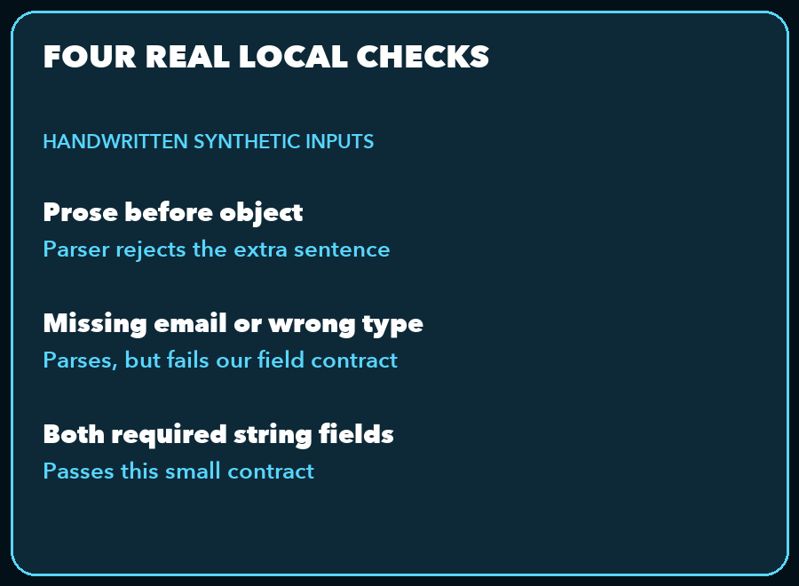

# Your AI Answer Looks Right. Will Your Automation Accept It?

Your AI answer looks right. Will your automation accept it? That question matters whenever a conversational answer becomes input for another step. A person can read an introductory sentence, understand a missing label, and ask for clarification. A program needs an explicit way to decide what it received and whether that input meets the job's requirements.

I use four small, hand-authored contact examples to show that boundary. These are synthetic fixtures, not captured mistakes from an AI model. The Python checks are real, and their results are saved. Three examples parse as JSON. Only one also meets our small field contract. Those counts describe these four fixtures alone, not model accuracy or the reliability of another workflow.

## Start with the next step's input

The proposed next step needs a contact name and an email field. For this lesson, I define both as nonempty strings inside an object. That gives the check something concrete to assess. It does not silently choose a record shape from whichever answer happened to arrive last.

Our example contact is Alex Example with the address alex@example.com. This is teaching data. Nothing sends a message, accesses a customer account, or adds a person to a real list. Keeping the example local makes it possible to inspect every input and result without involving an external service.

An input contract is a description of what this particular step accepts. Another workflow might require a customer identifier, a timestamp, or a list of items instead. The lesson is to name those requirements before the handoff. There is no universal contact contract hidden inside the word JSON.

## Separate JSON parsing from field checks

JSON is a format for structured data interchange. The [JSON specification](https://www.rfc-editor.org/rfc/rfc8259) describes its syntax and value types. Python's [JSON documentation](https://docs.python.org/3/library/json.html) describes decoding text into Python values and the decoding errors that can occur. Neither document establishes the business fields our particular workflow needs.

I therefore perform two separate checks. First, can the decoder read the supplied text? Second, does the resulting value meet the local requirements? A successful first check does not imply a successful second one. Keeping the results separate makes the failure understandable.

The local checker also requires an object before inspecting named fields. A JSON value can have another shape, so the field check needs to say what it expects. Our examples are deliberately small; the checker is a teaching implementation rather than a comprehensive production input validation library.

## The readable sentence that fails parsing

The first fixture begins with the words Here is your contact, followed by an object containing a name and email. A reader can understand the intention. Our actual call to Python's JSON decoder rejects the entire supplied text because of the sentence before the object.

That result is a property of the exact input and decoder call we saved. I do not describe it as a spontaneous model failure. The sample was written by hand to demonstrate the distinction between a conversational answer and the format this handoff requires.

If an assistant is drafting the input, the prompt can explain the required shape and ask for no surrounding prose. That instruction is helpful direction, but the receiving step still needs its own check. A request in a prompt is not a recorded result from the parser.

## Valid JSON can still be incomplete

The second fixture contains a name but omits email. Python decodes the object successfully. Our field check then rejects it because one required nonempty string is missing. The recorded result therefore says parsing passed and the local contract failed.

This is why a single green message saying valid can be misleading. Valid according to which requirement? In this lesson, syntactically readable data and a complete contact record are different properties. I want the report to name which one was actually checked.

A missing email should remain a missing email. The workflow should not invent one, reuse an address from a prior example, or advance merely because the object is readable. A useful failure message gives the responsible person enough information to repair the record without disguising the gap.

## The right field can have the wrong type

The third fixture includes both field names but puts the number 42 in email. That number is valid JSON data. It does not meet our local requirement for a nonempty string, so the contract check rejects the record after parsing succeeds.

The example shows why checking only whether a field exists is insufficient for this contract. Its value must have the expected type and meet the limited nonempty requirement. The saved checker makes those choices explicit so a reader can reproduce the behavior.

Automatically converting every unexpected value into text would change the rule. The string 42 would still not establish a usable email address. A production workflow needs deliberate decisions about conversion, address validation, permission and errors rather than treating conversion as proof that the original data was suitable.

## Understand what the passing case proves

The fourth fixture supplies both required fields as nonempty strings. It passes parsing and our local field check. That is the full scope of the positive result. It does not establish that the address exists, that messages can be delivered, or that the named person agreed to receive them.

It also does not verify the accuracy of information drafted by an assistant. A field can have the right type and contain the wrong fact. If the next action has consequences, the workflow needs whatever source checks and authorization apply to that action.

The chart therefore labels its counts as synthetic fixture results. Three of four inputs parsed, and one of four met this contract. It is a comparison of two checks over an intentionally chosen teaching set. It is not a success rate for an AI product or a performance claim about a customer system.

## Hold failures before the next action

The illustrative flow has three stages: parse the input, check the fields and types, and decide whether the next step may proceed. A failed input stays held with its reason. A passing input becomes eligible for whatever additional checks the intended action requires.

I would keep a small record of the input identity, check version, outcome and unresolved work. The purpose is to explain what happened when a handoff fails. That record should avoid copying unnecessary private information into logs or public examples.

The [lesson about checking an AI quote](/blog/ai-quote-unit-price-versus-carton-price/) makes a related point about meaning: correctly formatted prices still need explicit units and sales rules. Here the focus is the receiving program's structure requirements. Neither check replaces the other.

## Turn one example into a repeatable check

Start with a harmless sample and write down the next step's required fields. Try an example with surrounding prose, one with a missing field, one with the wrong type and one that meets the stated requirements. Keep the actual inputs and outputs together.

Those cases help explain the contract and make later changes reviewable. If a new version accepts an input that was previously rejected, inspect whether the rule intentionally changed. Do not assume that a different result is better merely because it lets more records continue.

An [SOP](/blog/what-is-an-sop-and-why-ai-needs-one/) can hold the contract, the examples and the decision about failed records. My practical next step is small: validate one sample before connecting the next step. A readable answer is a useful start; a checked handoff is what this automation needs.

## Sources and local evidence

- [Python JSON documentation](https://docs.python.org/3/library/json.html).
- [RFC 8259: JSON data interchange format](https://www.rfc-editor.org/rfc/rfc8259).
- Fused local Python demonstration, November 22, 2026: four hand-authored synthetic fixtures; parsing results false, true, true, true; local contract results false, false, false, true. No model or sending service was called.

## Related

- [Give an AI quote explicit units and sales rules](/blog/ai-quote-unit-price-versus-carton-price/)
- [Write a useful AI prompt for one task](/blog/write-a-useful-ai-prompt-for-one-small-business-task/)

Read next: [What is an SOP and why does AI need one?](/blog/what-is-an-sop-and-why-ai-needs-one/).
