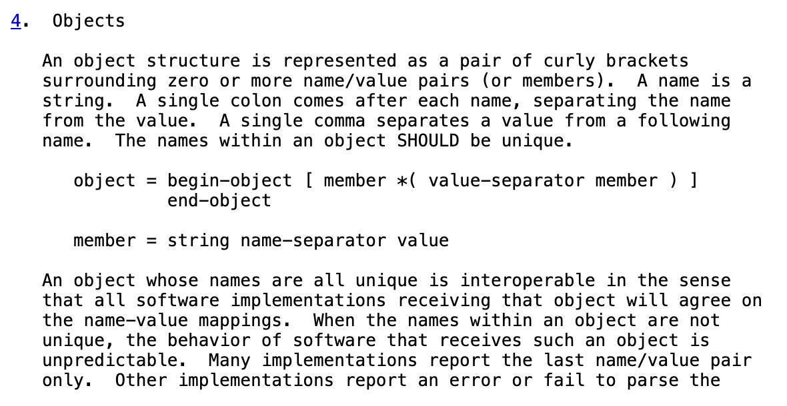
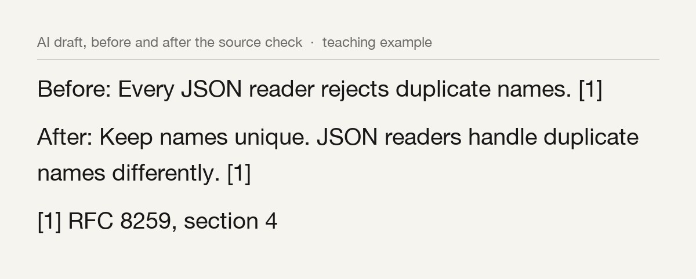

# The Link Was Real. The AI Claim Was Still Wrong.

An AI answer with a citation looks finished. The link opens, the title matches, the publisher is official. Most quick checks stop right there.

That check proves the source exists. It doesn't prove the source says what the answer claims. To check that, you have to open the source, find the sentence, and test the strongest word in the claim. If you use AI for research or drafting, pair this with [building AI prompts that actually work](/blog/how-to-build-ai-prompts-that-actually-work/) so you ask for sources in the first place.

## The teaching example

Here's a draft line I wrote for this lesson, in the style of an AI answer:

> Every JSON reader rejects duplicate names. (Source: RFC 8259, The JSON Data Interchange Format)

RFC 8259 is the official JSON standard. The citation is real, the title matches, and the publisher, the IETF, checks out. A link checker would pass it.

## Open the source and find the sentence

Section 4 of RFC 8259 covers objects. The sentence about names is short.

It says: "The names within an object SHOULD be unique." Should, not must. In standards writing, that's a recommendation, not a requirement.

Keep reading and it gets more specific. When names aren't unique, "the behavior of software that receives such an object is unpredictable. Many implementations report the last name/value pair only. Other implementations report an error or fail to parse the object, and some implementations report all of the name/value pairs, including duplicates."

## Test the strongest word

The draft's strongest word is "every". Every JSON reader rejects duplicates.

The standard says the opposite: many readers keep the last value, some report an error, and some report all the pairs. So "every reader rejects duplicates" is false. One word broke the claim, even though the link, the title and the publisher were all correct.

Words to watch for: every, always, never, all, only, must, guaranteed, best. In standards and policy documents, watch should versus must, may versus will, and some versus all.

## Fix the line

The fixed line says only what the source supports:

Keep names unique, because JSON readers handle duplicate names differently. Same citation. Now the citation supports the sentence.

Put the original sentence and the source passage side by side when you make a change like this. Anyone who reads your draft later can see exactly why the wording changed.

## The source check, step by step

1. Find the claim and the source it cites.
2. Open the source. Don't stop at the title or the publisher.
3. Find the exact sentence that should support the claim, and copy it next to the claim.
4. Find the strongest word in the claim.
5. Ask whether the source sentence justifies that word.
6. If it doesn't, rewrite the claim to match the source, or remove it.
7. Keep the source sentence and the link with the final text.

No source sentence, no claim. Numbers have to match too, including the unit and the year. The same habit works when you [summarize your own document with AI](/blog/summarize-your-own-document-with-ai/): ask for the lines the summary relied on, and spot check them.

Try it on the sentence your next business decision depends on. It takes a couple of minutes.

## Get the SOP

This source check is SOP 6 in my free [example AI SOPs](/ai-sops/), along with an AI output review checklist you can run on any draft before it leaves your business.

## Sources

- [RFC 8259, The JavaScript Object Notation (JSON) Data Interchange Format](https://www.rfc-editor.org/rfc/rfc8259.html), section 4, IETF, December 2017. Checked November 23, 2026.
- The draft line is a made up teaching example in the style of an AI answer. No claim is made about how often any AI tool produces unsupported citations.

## Related

- [How to build AI prompts that actually work](/blog/how-to-build-ai-prompts-that-actually-work/)
- [Summarize your own document with AI](/blog/summarize-your-own-document-with-ai/)
- [Draft a customer email with AI and review it before sending](/blog/draft-a-customer-email-with-ai-and-review-before-sending/)

Read next: [How to build AI prompts that actually work](/blog/how-to-build-ai-prompts-that-actually-work/).
