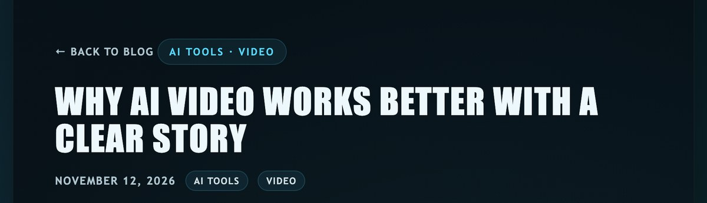
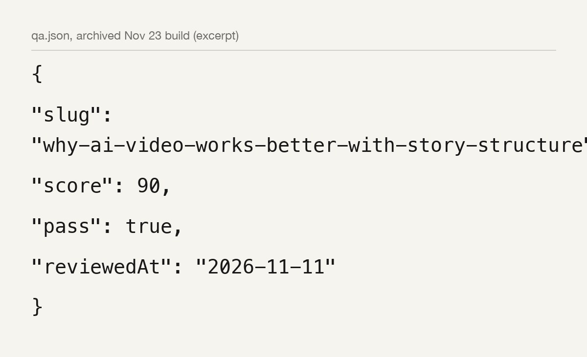
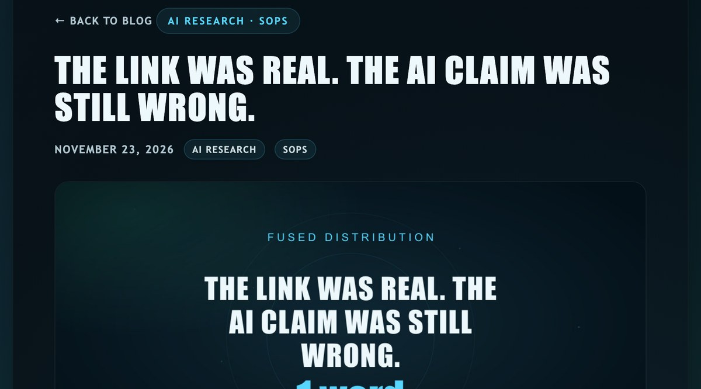

# Our AI Graded Its Own Work. It Was the Wrong Article.

On November 23, our own AI content pipeline built a blog package, reviewed it, and gave it 90 out of 100. It passed. It was the wrong article.

The page was supposed to explain how to check whether an AI citation supports a claim. The URL said so, the description said so, the reel hook said so. The body was an older post about why AI video needs a clear story. I caught it while reviewing the reels by hand, rebuilt the posts, and changed how review works. This is the short version of what went wrong and the check that would have stopped it. If you're deciding where people belong in an AI workflow, start with [when an AI workflow needs human review](/blog/deciding-when-an-ai-workflow-needs-human-review/).

## What the review file said

The pipeline saves a review record next to every post. Here are the lines that matter from the archived file.

Score 90. Pass true. And the slug inside the review is the older video post, not the citations post it was filed under. The review named the wrong article and still said pass.

## Why a writer can't grade itself

The same system wrote the package, reviewed it and signed it off. When a writer reviews its own work, it tends to check what it meant to write. It already "knows" the page is about citations, so it reads past the fact that the text isn't.

People do this too. That's why newspapers have editors and why you ask someone else to proofread your proposal. AI doesn't remove the need for a second reader. It makes it easier to skip one, because the output looks finished.

## Split the jobs

The fix is boring, which is why it works.

1. One step writes.
2. A different reviewer reads the finished output cold. That's a person, or a second tool that gets only the output and a checklist, never the writer's notes or plan.
3. The reviewer can fail the draft and send it back with a reason. It doesn't quietly fix things.
4. Nothing publishes on the writer's own approval.

## Three checks that catch most of this

Before the full checklist, the reviewer asks three questions.

- **Does the title match the body?** Read the title, then the first two paragraphs. Do they promise the same thing?
- **Does every number have a source?** Every figure, price and date traces to a line you can open. See [checking whether an AI citation supports the claim](/blog/ai-citations-check-source-supports-claim/).
- **Would I send this to a customer?** If you'd hesitate, it isn't done.

The first check alone would have failed this post. The title and the body were about different things.

## Get the checklist

The writer and reviewer split is SOP 13 in my free [example AI SOPs](/ai-sops/), and the full review checklist is SOP 8. For customer facing drafts, the same idea applies to [drafting a customer email with AI and reviewing it before sending](/blog/draft-a-customer-email-with-ai-and-review-before-sending/).

## Sources and local evidence

- Archived Fused build of November 23, 2026: qa.json (score 90, pass true, slug of an older post) and the generated index.html (citations URL, older post's title). Kept unchanged in our archive.
- No claim is made about how often AI review misses errors in general. This is one real case from our own pipeline.

## Related

- [When an AI workflow needs human review](/blog/deciding-when-an-ai-workflow-needs-human-review/)
- [The link was real. The AI claim was still wrong.](/blog/ai-citations-check-source-supports-claim/)
- [Draft a customer email with AI and review it before sending](/blog/draft-a-customer-email-with-ai-and-review-before-sending/)

Read next: [When an AI workflow needs human review](/blog/deciding-when-an-ai-workflow-needs-human-review/).
