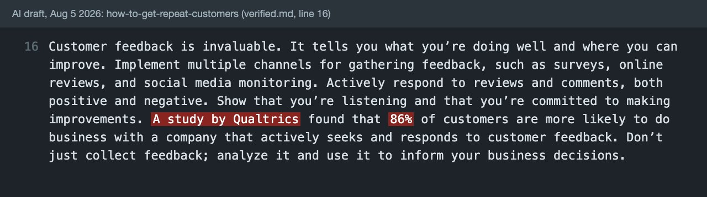
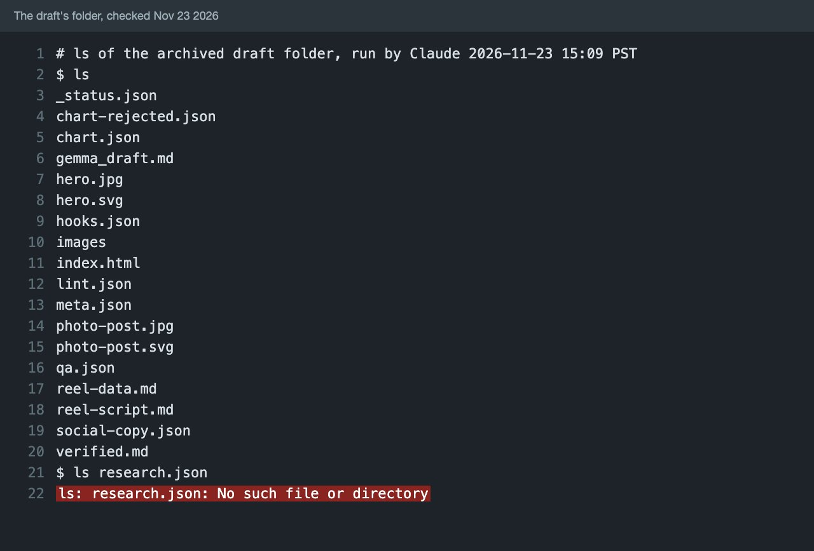
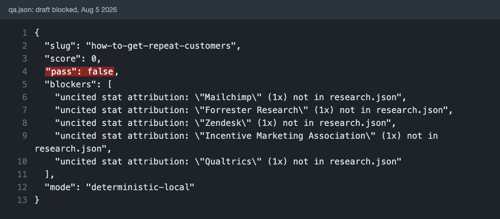
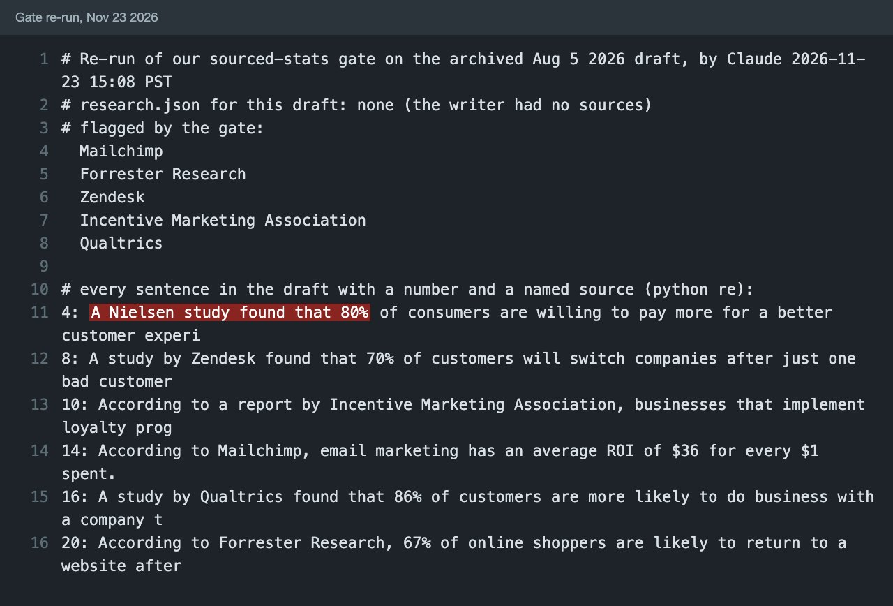

# AI Will Invent a Statistic and Say It With Total Confidence

In August 2026 our AI wrote a blog draft with six statistics in it. Each one had a percent or a dollar figure and a company name: Nielsen, Zendesk, Mailchimp, Qualtrics, Forrester and a trade association. It read like research. The AI had no sources for that post. Not one link, not one file.

Our checker blocked the draft before it went live. It caught five of the six. This is the real draft, what the checker did, what it missed, and the habit that covers the gap.

## The line that looked real

Here's one sentence from the draft, exactly as the AI wrote it:

> A study by Qualtrics found that 86% of customers are more likely to do business with a company that actively seeks and responds to customer feedback.

A named company, a clean percent, a confident verb. Nothing in the sentence tells you it came from nowhere. The other five read the same way. One credited Mailchimp with an email return of $36 for every $1 spent. Another credited Zendesk with 70 percent of customers switching after one bad experience.

I'm not saying none of those companies ever published a number like that. Some of these figures float around the web with different sources attached. I'm saying the AI didn't read any of them. The writer for that post got a topic and no research file. So none of those six numbers came from a source it was given. It wrote them as if it had just looked them up.

## Why AI does this

A language model writes the most likely next words. In a blog post about repeat customers, the most likely next words after "a study by" are a well known company name and a round looking percent. That's what sounds right, so that's what it writes.

Numbers sound right very easily. "86%" feels precise, and precise feels true. That's the trap. The confidence is in the writing style, not in the facts.

We've seen the other half of this too. In July, before our checker existed, a published post on our site said "92% of consumers trust online reviews as much as personal recommendations" and credited BrightLocal. BrightLocal's current Local Consumer Review Survey (2026) puts that figure at 49%. We corrected the post on July 8. The number had the right company name and the wrong value.

## Our rule: no source, no number

In July, alongside that fix, we added one rule to our publishing system: no source, no number. Any sentence that credits a named source has to match a source we actually collected for that post. If it doesn't, the draft can't go live.

Here's the record our checker wrote for the August draft:

Score 0. Pass false. Five blockers, one for each company name it couldn't trace. The draft never reached the site.

## What the checker missed

When I ran the same checker on the same draft again this week, it flagged the same five. Then I listed every sentence in the draft with a number and a company name. There were six.

"A Nielsen study found that 80%..." got through. The checker looks for phrases like "according to" and "a study by". This sentence put the name before the word study, so the pattern didn't match. The draft was blocked anyway, because of the other five. But if Nielsen had been the only claim, it would have passed.

That's the honest limit of any automatic check. It catches the shapes you wrote it to catch. A person still has to look.

## The habit that covers the gap

Before you post anything AI wrote, do this:

1. **Circle every number.** Percents, dollar figures, counts, years, "most", "half", "twice as many". On paper or with a highlighter in your editor.
2. **Open where it came from.** Not the company's home page. The page or report with that exact number on it.
3. **Match it exactly.** Same number, same unit, same year, same group of people. "86% of customers" and "86% of B2B buyers in Germany" are different claims.
4. **No source, cut it.** If you can't find it in a few minutes, delete the number and say the point in plain words instead. "Customers notice when you ask for feedback" is fine without a percent.
5. **Keep the source next to the claim.** A link in the post, or at least in your notes, so the next person can check it in one click.

If your AI tool shows links, open them. A real link can still point to a page that says something else. We covered that case in [the link was real, the AI claim was still wrong](/blog/ai-citations-check-source-supports-claim/). And don't let the same AI that wrote the draft be the only one that checks it. That's [the writer grading its own work](/blog/ai-graded-its-own-work-wrong-article/).

## Get the source check

The step by step source check is SOP 6 in my free [example AI SOPs](/ai-sops/), and the review checklist I run on every AI draft is SOP 8. Both are short enough to print and keep next to your screen.

## Sources and local evidence

- Our archived draft of August 5, 2026 (`how-to-get-repeat-customers`, blocked): the draft text and its review record (score 0, pass false, five uncited source names). No research file existed for that draft.
- Our checker run again on November 23, 2026 with the same code: flagged Mailchimp, Forrester Research, Zendesk, Incentive Marketing Association and Qualtrics. Did not flag "A Nielsen study found that 80%".
- BrightLocal, Local Consumer Review Survey 2026, https://www.brightlocal.com/research/local-consumer-review-survey/ (checked November 23, 2026): "it still sits at a significant 49% today" for trusting online reviews as much as personal recommendations.
- Our July 8, 2026 correction of a live post that had said 92% and credited BrightLocal.
- No claim is made about how often AI models invent numbers. These are real cases from our own system.

## Related

- [The link was real. The AI claim was still wrong.](/blog/ai-citations-check-source-supports-claim/)
- [Our AI graded its own work. It was the wrong article.](/blog/ai-graded-its-own-work-wrong-article/)
- [Our AI gave the same price four times. It was wrong every time.](/blog/ai-same-price-four-times-wrong-every-time/)

Read next: [The link was real. The AI claim was still wrong.](/blog/ai-citations-check-source-supports-claim/)
