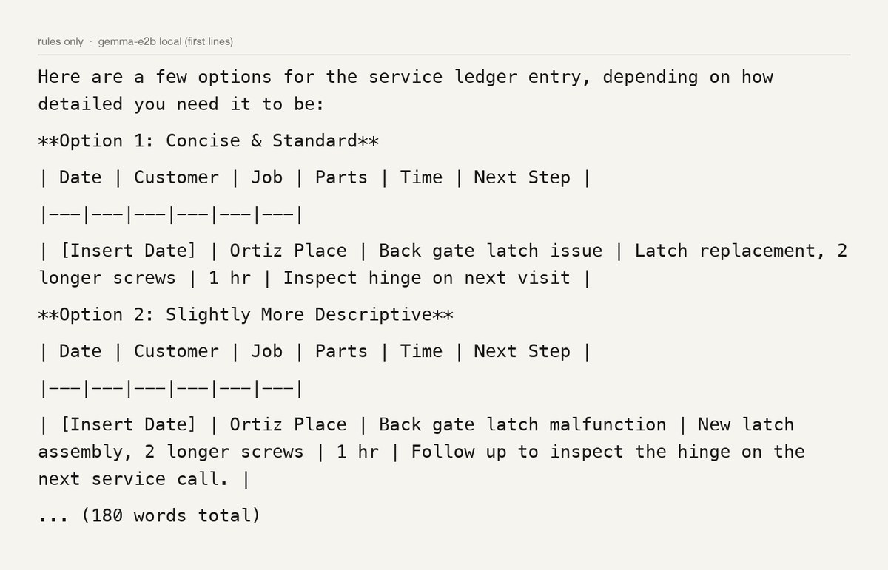
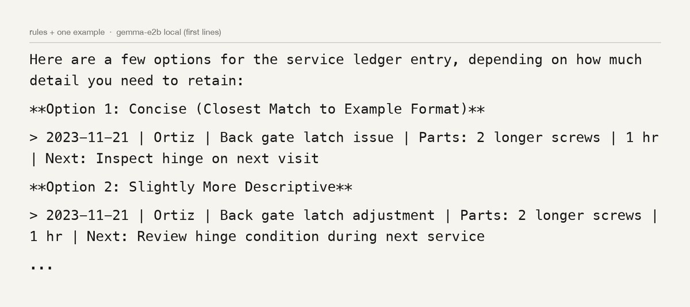
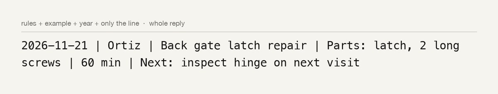

# I Asked AI for One Line. It Gave Me 180 Words.

I wanted one line for a service ledger. I gave a local AI model a technician's note and clear rules. It gave me 180 words, three options, three tables, and a placeholder where the date should be.

One real example fixed the format. Two small facts fixed the rest. Here's the run, step by step, with the actual outputs. If you haven't set up a prompt structure yet, [how to write a useful AI prompt for one small business task](/blog/write-a-useful-ai-prompt-for-one-small-business-task/) is a good start.

## The teaching example

A technician's note, written the way people actually write notes:

> went to the Ortiz place on Nov 21, back gate wouldn't latch, swapped the latch and added two longer screws, took about an hour, should look at the hinge next visit

The goal is one line in our ledger format: date, customer, job, parts, time, next step.

## Run 1: rules only

The instruction was: turn this into one ledger entry, include the date, customer, job, parts, time and next step, keep it short.

Three options, each a markdown table, and "[Insert Date]" instead of a date. Every rule was technically covered. None of it was usable as a ledger line.

## Run 2: rules plus one example

Then I added one real line from our ledger, so the model could see what done looks like:

`2026-11-20 | Lee | Replaced door closer | Parts: closer, 4 screws | 45 min | Next: check closer in 30 days`

Now it matched the format. But it still gave three options, guessed the year as 2023, and listed only the screws as parts. The latch it swapped was missing.

## Run 3: two facts

I added two sentences: the year is 2026, and reply with only the one ledger line.

One line. Right date, right parts, our format.

## What this shows

Rules tell AI what you want. An example shows what done looks like. They do different jobs, so use both. And an example doesn't check facts for you. The model filled the gap in the note with a guess, so you still read the output against the source.

Practical version:

1. Pick a real output you were happy with. That's your example.
2. Put it in your SOP under its own heading, so it travels with the rules. See [what an SOP is and why AI needs one](/blog/what-is-an-sop-and-why-ai-needs-one/).
3. Give the facts the note leaves out, like the year.
4. Say exactly what to return: "only the one line".
5. Check the output against the original note.

## Get the template

The SOP template in my free [example AI SOPs](/ai-sops/) now has an Example section built in (SOP 1). If your prompts are getting long, [the master SOP and task brief method](/blog/shorter-ai-prompts-master-sop-task-brief/) keeps them short.

## Sources and local evidence

- Local test on November 23, 2026, model gemma-e2b served by LiteRT on a Mac, temperature 1.0. Raw prompts and outputs are saved with the reel's evidence files. The 180 word count is from the first run's output.
- The note and the customer are made up teaching examples. One small model, one task. No general accuracy claim is made.

## Related

- [Write a useful AI prompt for one small business task](/blog/write-a-useful-ai-prompt-for-one-small-business-task/)
- [What is an SOP and why AI needs one](/blog/what-is-an-sop-and-why-ai-needs-one/)
- [Your SOP has six rules. This AI reply needs three.](/blog/shorter-ai-prompts-master-sop-task-brief/)

Read next: [Your SOP has six rules. This AI reply needs three.](/blog/shorter-ai-prompts-master-sop-task-brief/).
