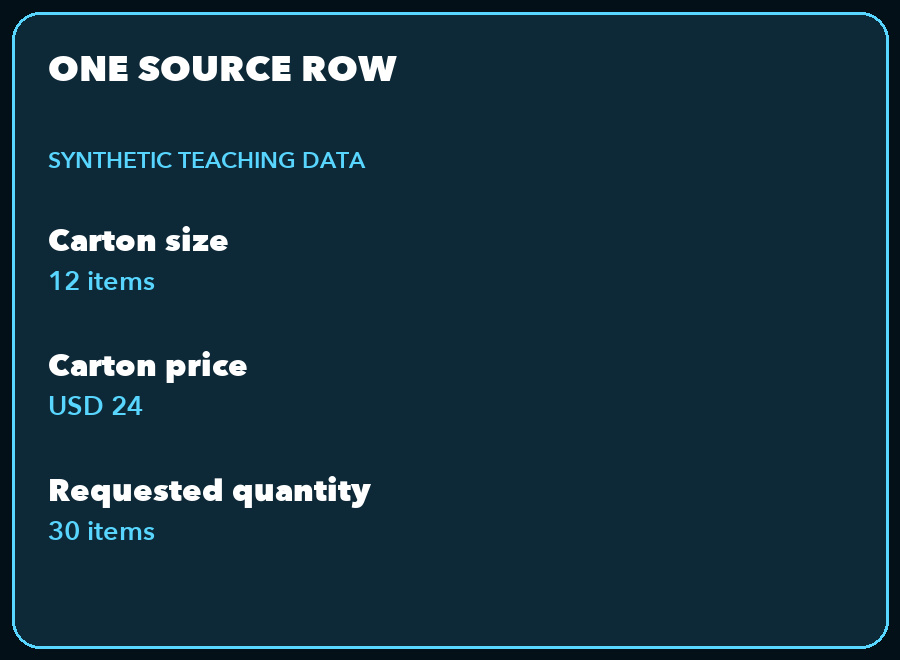

# AI Quotes: Check the Unit Price Before the Carton Price

Would your AI quote use the unit price or the carton price? Before I ask a model to draft a quote, I want the source row to answer that question. A price without a selling unit leaves a decision unresolved. The model can produce fluent wording while the business is still unclear about what the customer can buy.

I use one synthetic example in this lesson: twelve items per carton, USD 24 per carton, and a customer asking for thirty items. The arithmetic gives two useful answers. Individual items would total USD 60. Whole cartons would total USD 72 and supply thirty six items. Which answer belongs in the quote depends on the sales rule. These are made up prices, not a supplier offer or a model accuracy benchmark.

## Give every price a selling unit

A worksheet can look tidy and still leave its most important labels unstated. A column called price does not tell the reader whether the amount applies to an item, a carton, an hour, or an entire job. I put that unit beside the value before handing the row to an AI assistant or another person.

For this example, the input is explicit: currency is USD, a carton contains twelve items, the carton price is 24, and the requested quantity is thirty items. I keep requested items separate from ordered cartons. That distinction makes it possible to explain why the delivered quantity can differ from the quantity in the customer's request.

The remaining question is whether a carton can be split. That is a business rule, so I do not ask the model to infer it from the numbers. If the source does not state the rule, the draft should flag the gap rather than quietly choose the answer that sounds convenient.

## Calculate the individual item case

If individual sales are allowed at the same proportional price, divide USD 24 by twelve items. The example's unit price is USD 2. Multiply that by thirty requested items and the subtotal is USD 60. The delivered quantity in this case is exactly thirty items.

The word if matters. Dividing a carton price does not establish that a supplier sells individual items at that rate. The calculation describes the stated teaching scenario. A real supplier may have a separate individual price, a minimum quantity, or a different purchasing rule. I would need that information before turning the example into an actual offer.

I also label the result subtotal. The example does not supply tax, delivery, discounts, or other charges, so the calculation does not invent them. A quote that needs those fields should show them as unresolved until an approved source provides the values.

## Calculate the whole carton case

If only whole cartons are available, thirty divided by twelve is two and a half cartons. Two cartons would supply only twenty four items, which is short of the requested quantity. The next whole number is three cartons. At USD 24 each, that totals USD 72 and supplies thirty six items.

The extra six items should be visible in the draft. They are part of the fulfillment choice, not a rounding detail to hide in the total. I want the reviewer to see the requested quantity, the quantity supplied, the number of cartons, and the price together before agreeing to the result.

This case does not prove that USD 72 is always the correct quote. It shows what follows from the whole carton rule in the synthetic row. The same numbers under the individual sale rule lead to USD 60. Naming the rule is what makes the answer checkable.

## Use the model to explain the calculation

My example prompt gives the row and asks for both cases: calculate thirty items when individual sales are permitted, then calculate the order when only whole cartons are permitted. It also tells the assistant not to guess the sales policy or add unstated charges. That request makes the unresolved business decision visible.

The saved assistant response in this session returned USD 2 per item, USD 60 for the individual case, and three cartons containing thirty six items for USD 72 in the whole carton case. It asked for the selling policy to be confirmed. That is an actual saved response to synthetic inputs, not evidence that a particular model is consistently accurate.

I checked the result separately with Python's Decimal arithmetic. The [Python Decimal documentation](https://docs.python.org/3/library/decimal.html) explains how decimal values can be represented and calculated without the binary approximation associated with some floating point values. Here the calculation is simple; the independent check establishes only the recorded example's arithmetic.

## Keep the source row beside the draft

A polished paragraph is harder to review when the input has disappeared into a long chat. I keep the small source table with the output. The reviewer can then compare the price, unit, currency, quantity, and carton rule without reconstructing the conversation.

This is also a useful way to limit the task. The model can turn approved facts into readable wording, explain the two cases, and identify missing information. The person responsible for pricing still decides which selling rule applies and which totals are approved for a real customer.

The [lesson on writing one useful AI prompt](/blog/write-a-useful-ai-prompt-for-one-small-business-task/) uses the same approach: define the job and the information the answer may use. Here the concrete improvement is adding the unit and fulfillment rule before requesting the calculation.

## Record assumptions before reusing a template

If this becomes a recurring workflow, I would save fields for product, currency, price unit, pack size, requested quantity, selling rule, and exclusions. A missing field should leave the draft incomplete. The template should not silently inherit a previous customer's rule.

I would also keep an example of each supported case with its expected result. The two totals in this lesson make a small regression check: individual items produce 60, while whole cartons produce 72 and thirty six supplied items. If a later change gives a different result, inspect the input and calculation before sending the draft.

An SOP can hold those decisions in one place. The [SOP introduction](/blog/what-is-an-sop-and-why-ai-needs-one/) explains why a repeatable instruction is more useful than rebuilding a process through repeated prompts. The rule here is specific: an unlabeled price does not become approved because AI has formatted it neatly.

## Make the next action small

Start with one synthetic product row. Give it a currency, a selling unit and a quantity. Ask the assistant to show its assumptions, then verify the arithmetic and the fulfillment choice separately. Keep any unknown charge or policy visible.

The lesson's bar chart compares conditional subtotals, not business performance. Its flow explains how the sales rule changes the quantity supplied. Both graphics support the same practical point: label the units before asking AI to calculate.

## Sources and local evidence

- [Python Decimal documentation](https://docs.python.org/3/library/decimal.html).
- Fused teaching calculation, November 22, 2026: twelve items per carton, USD 24 per carton, thirty requested items; verified totals of USD 60 and USD 72 under the stated conditions.
- Saved Codex assistant response and independent Decimal output. The tool interface did not expose an exact model identifier, so this is not a named-model benchmark.

## Related

- [Write a useful AI prompt for one task](/blog/write-a-useful-ai-prompt-for-one-small-business-task/)
- [What is an SOP and why does AI need one?](/blog/what-is-an-sop-and-why-ai-needs-one/)

Read next: [Check what an MP4 actually contains](/blog/ffprobe-check-mp4-container-video-audio/).
