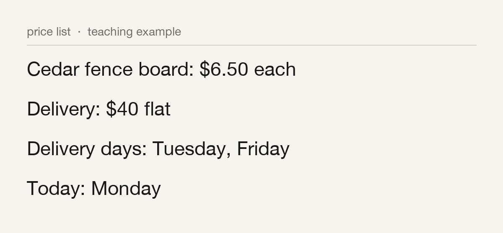
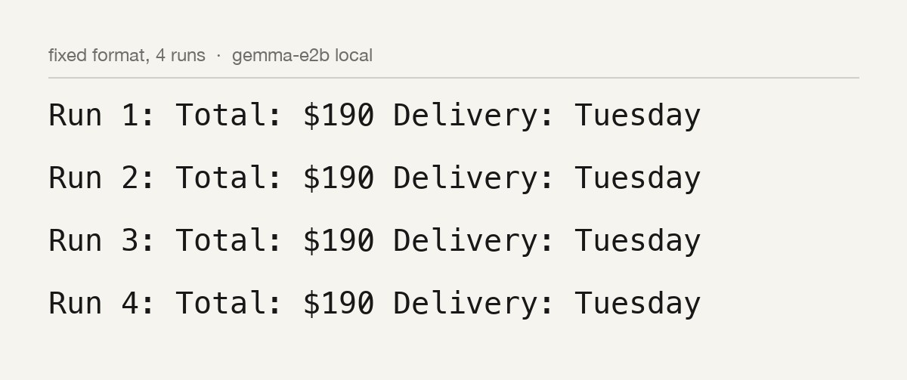
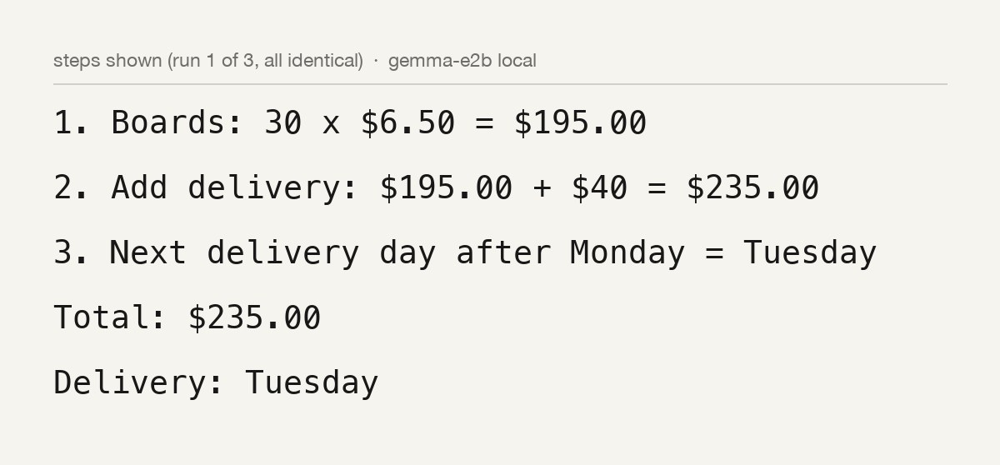

# Our AI Gave the Same Price Four Times. It Was Wrong Every Time.

It's easy to trust an AI answer that comes out the same every time. Consistency feels like accuracy. I ran a small pricing test on a local AI model and it showed why those are different things.

The setup is a teaching example, not a real supplier. Thirty cedar fence boards at $6.50 each, plus $40 flat delivery, delivered Tuesdays and Fridays, and today is Monday. The right answer is $235, delivered Tuesday. If quotes are part of your work, [the unit price versus carton price example](/blog/ai-quote-unit-price-versus-carton-price/) covers a related trap.

## Run 1: a normal reply quoted two totals

I asked for a short reply to the customer. The model wrote three options in one reply. Option 1 said $195, which leaves out delivery. Option 2 said $235. If you copied the first option, the customer got the wrong price.

## Runs 2 to 5: same answer, four times, all wrong

So I tightened it: a fixed answer format, the pricing rule written out, nothing else in the reply. Four runs gave the exact same answer four times.

Total: $190. Consistent, and wrong every time. When I changed one setting (the temperature, which controls how much randomness the model uses), it gave $205 and Friday instead. Also wrong, and a different wrong.

## The fix: make it show the steps

Then I asked it to work through the steps before answering: boards first, then delivery, then the delivery day.

Three runs, three correct answers: $235, delivered Tuesday. Writing the steps out gave it, and me, something to check.

## What to do with this

The same answer every time doesn't mean the right answer. For anything with a price, a total or a date:

1. Give the AI the exact numbers: unit price, quantity, fees, the date rule.
2. Ask it to show each step.
3. Check each step against your price list.
4. For quotes and invoices, let a spreadsheet or your invoicing tool do the math, and use AI for the wording.

Before you put AI in front of customers, it also helps to [build a small test set of real questions](/blog/building-a-test-set-for-ai-customer-support-drafts/) and rerun it whenever you change the instructions.

## Get the checklist

How I handle AI and numbers is SOP 14 in my free [example AI SOPs](/ai-sops/), and the review checklist (SOP 8) now includes a math check. For writing the request itself, see [how to write a useful AI prompt for one small business task](/blog/write-a-useful-ai-prompt-for-one-small-business-task/).

## Sources and local evidence

- Local test on November 23, 2026, model gemma-e2b served by LiteRT on a Mac, temperature 1.0 unless noted. Raw prompts and outputs are saved with the reel's evidence files.
- Teaching prices only. This is one small model on one task. No claim is made about how often any AI model gets math wrong.

## Related

- [Would your AI quote use the unit price or the carton price?](/blog/ai-quote-unit-price-versus-carton-price/)
- [Build a test set for AI customer support drafts](/blog/building-a-test-set-for-ai-customer-support-drafts/)
- [Write a useful AI prompt for one small business task](/blog/write-a-useful-ai-prompt-for-one-small-business-task/)

Read next: [Would your AI quote use the unit price or the carton price?](/blog/ai-quote-unit-price-versus-carton-price/).
