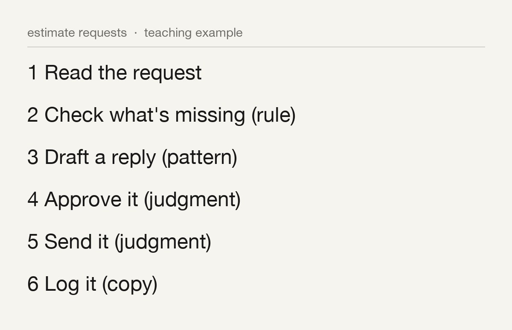

# Automation Is Not a Robot. It's a List of Steps.

When someone says "we should automate that", it usually sounds like buying a robot. In practice, automation is a list of steps you stop doing by hand, one step at a time. Before you buy an AI tool, write down the steps you already do.

I covered how to [map a manual business process before automating it](/blog/mapping-a-manual-business-process-before-automating-it/) in October. This is the quick version: one task, six steps, and a simple way to mark which ones a machine can take.

## The teaching example

A repair shop gets an estimate request by email. Here are the steps someone already does, in order:

1. Read the request.
2. Check what's missing.
3. Draft a reply.
4. Approve it.
5. Send it.
6. Log it.

## Mark each step

Ask one question of every step: is it the same every time? Then give it one of four labels.

- **Rule:** the same decision every time. Checking whether the size or the material is missing is a rule.
- **Pattern:** similar every time, with small changes. Drafting the reply is pattern work.
- **Copy:** moving information from one place to another. Logging the job is copy and paste.
- **Judgment:** needs a person. Approving the reply, and anything with a price, is judgment.

Rule, pattern and copy steps can be automated. Judgment steps stay with a person. In this example that's three steps a tool can help with and two that stay yours. Reading the request is shared: a tool can sort it, a person still reads anything unusual.

## Automate one step at a time

Pick the most boring step first. Automate just that one, and run it next to the manual way for a week. Compare the results. If they match, move to the next step.

Keep the approval step yours. A draft that's never approved never goes out, and anything with a price or a promise gets a person's eyes every time. If a step reads documents or email, the [who asked for this action check](/blog/ai-document-hidden-instructions-prompt-injection/) belongs in it too.

## Why start with the list

The list tells you what you actually need. Maybe it's a template and a spreadsheet, not a new subscription. Maybe the slow step is approval, which no tool should take. And when something breaks, you know exactly which step to look at.

If you're not sure where to begin, [choosing a low risk first AI task](/blog/choosing-a-low-risk-first-ai-task-for-a-small-business/) helps you pick.

## Get the template

The step list template is SOP 15 in my free [example AI SOPs](/ai-sops/), with SOP 10 for approvals when AI is connected to email, files or payments.

## Sources

- Teaching example based on the estimate desk procedure in the Fused example SOP pack. No tool, cost or time saving claims are made.

## Related

- [Map a manual business process before automating it](/blog/mapping-a-manual-business-process-before-automating-it/)
- [Choose a low risk first AI task for a small business](/blog/choosing-a-low-risk-first-ai-task-for-a-small-business/)
- [Text inside a document can steer your AI](/blog/ai-document-hidden-instructions-prompt-injection/)

Read next: [Map a manual business process before automating it](/blog/mapping-a-manual-business-process-before-automating-it/).
