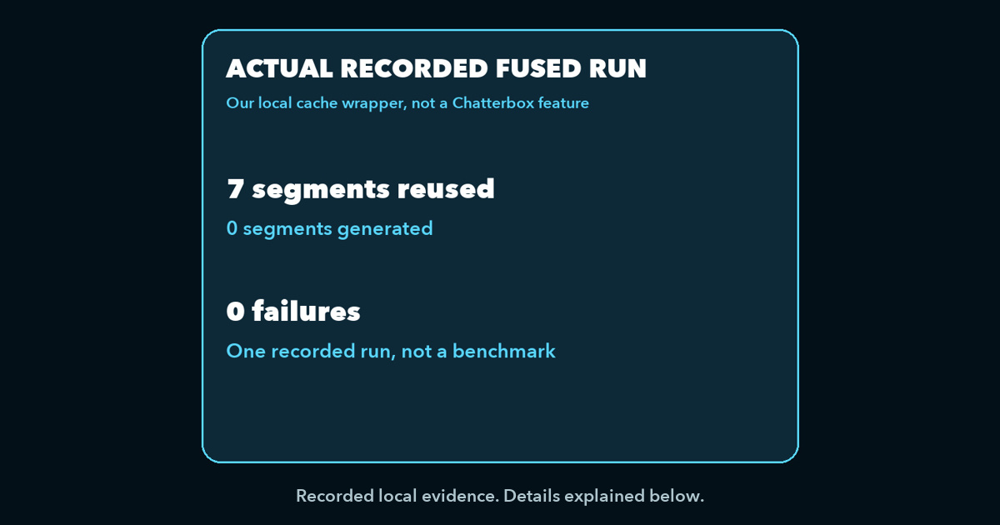

# Reuse Chatterbox Audio Only When Its Inputs Match

Can I reuse Chatterbox audio after changing my script? I make that decision one segment at a time. A recording that still matches its text, voice reference, settings, and saved audio record may be reusable. A changed line needs new speech. The existence of an audio filename is not enough to decide which case applies.

The distinction matters because Chatterbox and our local workflow do different jobs. Chatterbox generates speech. Our cache wrapper checks whether a saved segment matches the inputs recorded for it. The reuse behavior shown here belongs to that wrapper; I am not presenting it as a built-in Chatterbox product feature or a claim about every installation.

## Separate Chatterbox speech from the cache decision

The [Chatterbox project](https://github.com/resemble-ai/chatterbox) is the source for the speech model used in this workflow. Our demonstration uses the pinned Chatterbox Standard runtime and Fused voice reference. We keep the generation configuration with the package rather than changing the voice model merely because a production step needs repair.

The cache is a separate layer around that speech work. It reads a segment's intended text and voice configuration, compares their recorded identity, and checks the saved audio bytes. If those checks agree, the workflow can keep the existing recording. If they disagree, it cannot treat the old filename as proof of a current result.

I keep that boundary visible in the reel. A record showing reused segments is evidence about our workflow's decision during a particular run. It is not documentation that Chatterbox itself offers an equivalent cache, and it does not establish that another creator's setup will make the same choice.

## What the recorded reuse result actually shows

One recorded Fused run reported seven segments reused, zero generated, and zero failures. I verified the original log against its saved hash before using those numbers in the lesson. The chart labels the result as one recorded run, rather than a performance comparison or a forecast for the next production session.

The result does not tell us how many minutes were saved, how much electricity was used, or whether a subscription's token allowance lasted longer. None of those outcomes were measured by that log. It tells us that the wrapper found existing audio acceptable for those segments and did not generate replacement speech in that run.

That limited result is still useful. It shows why a recovery process should inspect completed artifacts before requesting expensive work again. If the failed step is a subtitle design issue, the narration may remain usable. If the script itself changes, the affected audio needs another decision. The repair should follow the actual dependency that changed.

## Bind a segment to the exact narration inputs

I start with the text that is actually submitted for speech. That includes deliberate pronunciation substitutions used for tool names or numbers. Two display scripts can look similar while producing different speech inputs. The recorded key should describe the text the model received, rather than a shortened heading or an approximate summary.

Next, I include the voice reference and generation settings. A reference path is a location, not proof that the audio at that path remains unchanged. Our separate tech wrapper records the actual reference-file hash alongside the configured profile, model revision, and speech settings. Replacing the reference bytes should invalidate the old input match.

For the identity calculation, the [Python hashlib documentation](https://docs.python.org/3.14/library/hashlib.html) describes digest operations such as SHA256. Our workflow uses a digest as a compact comparison of the recorded inputs. A matching digest does not establish that the narration is factually correct or approved; it supports the narrower decision about whether those exact recorded inputs changed.

## Show a script edit without inventing a synthesis result

The lesson includes a labeled input key demonstration. I calculate a key for an approved example sentence and calculate it again with identical inputs. Those keys match. I then calculate a key after editing the sentence. The edited text produces a different key in the saved demonstration output.

This is a real calculation on sample inputs. It is not evidence that I generated the edited sentence as speech, and it is labeled as a demonstration. The diagram shows shortened prefixes for readability, while the complete values remain in the local evidence record. That makes the display readable without replacing the underlying comparison with a made-up result.

The demonstration answers a specific learner problem: changing the script can invalidate an audio segment even though a familiar WAV file still exists. It does not claim that a hash can hear pronunciation, detect an awkward pause, or judge a voiceover's design. Those questions require separate checks on the actual recording and finished video.

## Check the saved recording as well as its input key

Inputs alone are not the whole cache record. I also compare the saved audio file with the recorded audio hash. Otherwise, a recording could be replaced while the metadata still described an earlier file. Reuse should connect both sides: the intended generation inputs and the artifact that the workflow proposes to keep.

If either comparison fails, I preserve the old recording as a rejected or superseded version and generate the required replacement. I do not delete completed evidence just to make the working folder look cleaner. Preserving versions makes it possible to understand why a particular segment was replaced and which recording belongs to the current preview.

The same distinction appears in [checking an MP4 with ffprobe](/blog/ffprobe-check-mp4-container-video-audio/). A name locates a file, while inspection and exact-byte records establish facts about that file. Neither a filename nor a successful command from an earlier run proves that the current artifact is the one that was reviewed.

## Regenerate only the line whose inputs changed

Suppose a narrator misreads a technical phrase and the wording needs to be simplified. I revise that segment, update the approved production package, and invalidate its old input match. The remaining recordings can stay if their text, voice configuration, reference bytes, and saved audio still match their own records.

That is different from repeatedly restarting an entire batch. Repeating all narration can introduce new stochastic differences into lines that were already acceptable. It can also occupy the local speech worker while another repair waits. A segment-level decision gives the workflow a smaller, more reviewable change.

After replacement, I still check the speech and the final export. A valid input record cannot tell me whether the voice clipped a word or whether subtitles overlap during a chart. In the current preview repair, the video needed a caption-compositing change, so the checked narration was kept while new video versions were encoded.

## Keep reuse separate from approval

A reusable audio segment is not automatically authorized for publication. I keep the owner decision, the approved script, and the delivery action as separate evidence. An earlier approval to generate a preview does not by itself authorize posting that preview to a social account or publishing a matching article.

This is the same boundary explained in [using Python to find a missing approval file](/blog/python-find-missing-approval-file/). A file can exist without containing the permission that the next step requires. A cache key can match without proving that someone approved the content. The workflow should be able to report each condition honestly.

The answer to the hook is therefore conditional. I can keep unchanged narration after verifying the recorded inputs and the saved audio. When the text changes, I generate new speech for that line and check it. Reuse is a controlled artifact decision, not permission to skip listening, content review, or the owner's publishing instruction.

## Sources and demonstration

- [Chatterbox source project](https://github.com/resemble-ai/chatterbox): the speech synthesis model, distinct from our local cache wrapper.
- [Python hashlib reference](https://docs.python.org/3.14/library/hashlib.html): digest operations used in the comparison demonstration.
- Fused recorded run verified November 17, 2026: seven reused segments, zero generated, zero failures. Separate labeled hash demonstration: identical inputs matched and edited text differed; no new speech was generated by that calculation.

## Related

- [Use ffprobe to check what an MP4 contains](/blog/ffprobe-check-mp4-container-video-audio/)
- [Use Python to find a missing approval file](/blog/python-find-missing-approval-file/)

Read next: [Give AI a video brief before asking for a script](/blog/give-ai-a-video-brief-before-asking-for-a-script/).
