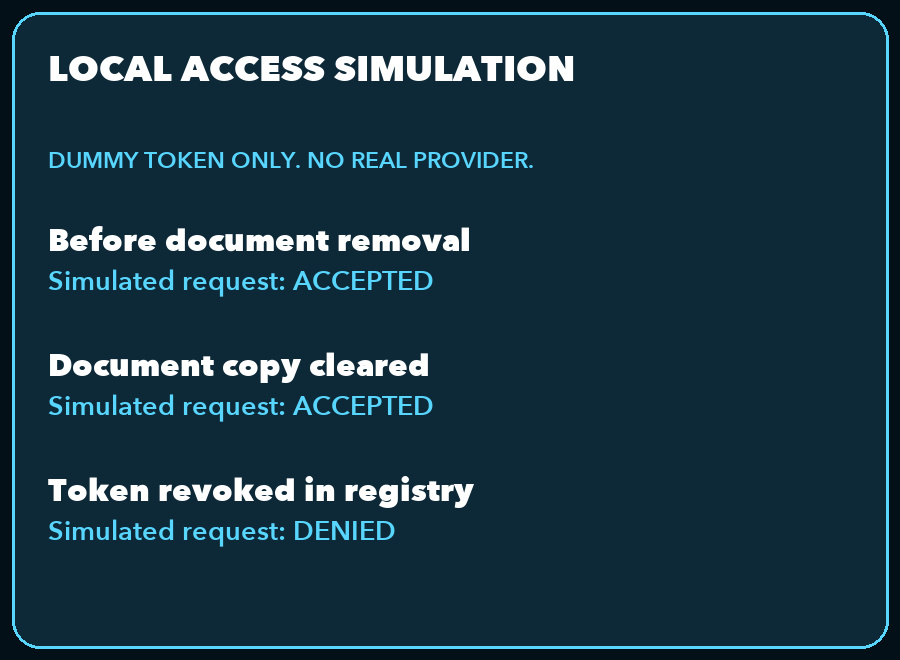

# Deleting a Leaked API Key Does Not Revoke It

You deleted the leaked API key. Why can it still work? Removing copied text and invalidating a credential are different actions. I use a small local simulation to make that distinction visible. The example clears a document copy, leaves a separate credential registry active, and then changes the registry's decision.

No real provider, account or production credential was used. The dummy token exists only inside the teaching code. Its simulated results are accepted before removal, accepted after the document copy is cleared, and denied after the registry revokes it. Those results explain a boundary; they do not establish that a real incident has been resolved.

## Separate the copy from the authority

A document can contain a credential without being the system that decides whether the credential works. In the teaching example, the document is just one copy of a dummy value. The registry is the separate part that decides whether a presented value is accepted.

That gives the demonstration a deliberately narrow scope. Clearing the document changes the document. It does not change the registry's active state. When the same dummy value is presented again, the registry still accepts it. Nothing in that second result requires the document to retain its copy.

The point is easier to follow when the two objects are shown separately. One box contains copied text. The other box represents an access decision. The flow between them is an illustration of why editing one location cannot be treated as proof that every other authority has changed.

## What the simulation actually checked

The code creates a clearly named dummy token and an active flag. Its check returns an accepted result only when the supplied token matches and the active flag remains true. The first check therefore reports accepted. This is an in-memory function call, not traffic to an API service.

Next, the code clears the document variable while keeping the active flag unchanged. The second check remains accepted. Finally, it changes the active flag to false and checks the same dummy value again. The third result is denied. The recorded values use familiar simulated status numbers, but no HTTP server received the requests.

The bar chart counts accepted checks in each state: one, one and zero. There was one attempted check per state. These are not breach statistics, customer counts, response times or evidence about a commercial provider. The label stays with the graphic so a viewer can understand exactly what was counted.

## Revoke the leaked key through its provider

For an actual exposed secret, the relevant authority is the provider that issued it. GitHub's [sensitive-data removal guidance](https://docs.github.com/en/authentication/keeping-your-account-and-data-secure/removing-sensitive-data-from-a-repository) says to revoke or rotate the secret first. Editing repository history is a separate decision with its own consequences.

That guidance supports the video's central distinction. It does not let me claim that our simulation tests GitHub, Buffer or any other service. The demonstration has no connection to those accounts. A real recovery needs the provider's current procedure and an authorized person responsible for that credential.

I would record what action was taken, which credential identity it affected, and what verification remains. I would avoid putting the secret value itself in the record. A status such as revoked should describe a confirmed provider action, rather than merely the disappearance of text from an editor.

## Keep replacement work visible

A service that legitimately used a credential may need a replacement after revocation. That creates another task to review: identify the authorized consumer, update it through the appropriate configuration process, and check the intended operation. The replacement should not be pasted into a new public document for convenience.

The [OWASP secrets management guidance](https://cheatsheetseries.owasp.org/cheatsheets/Secrets_Management_Cheat_Sheet.html) treats revocation, rotation and lifecycle management as explicit parts of managing secrets. I use that framing to keep the recovery steps separate. A replacement being created is different from consumers being updated, and both differ from confirming that old access is no longer accepted.

For a small workflow, I would make those states plain in the handoff. Name the system being checked and the intended action. Mark an untested consumer as untested. That is more useful than a single reassuring message saying the key was fixed while leaving the actual work unclear.

## Verify the property you mean to establish

The local simulation proves only its three recorded state transitions. It does not check a provider dashboard, cached permission, integration, audit log or another copy. I do not turn that narrow result into a general statement that the account is secure.

A real verification should be scoped to the question being answered. If the question is whether the exposed credential is invalid, the check needs evidence about that credential's access. If the question is whether an authorized service works with the replacement, that service needs its own relevant check.

The [GitHub workflow lesson](/blog/github-secrets-workflow-code-access/) examines another boundary: which code receives a stored secret. The [browser-variable lesson](/blog/nextjs-env-file-public-browser-variables/) examines where a value is delivered. Neither of those checks replaces incident recovery when a credential has already been exposed.

## Keep the recovery record useful and private

I would keep the affected system, credential identifier, responsible role, action time, verification result and unresolved work together. The identifier can describe which credential was involved without including the credential's sensitive contents. The record should help the next responsible person understand the state.

For this lesson, the complete evidence is safe to share because it uses synthetic data and an isolated in-memory registry. That is a property of the teaching example, not permission to share real incident material in the same way. Real logs and screenshots need review before being copied into a chat or public tutorial.

The demo also avoids changing a live account simply to make a video. Its visual clarity comes from labeling the states and showing the measured local output. A staged illustration should remain labeled instead of being dressed up as a provider screenshot or a live security test.

## Make the SOP distinguish actions and results

A repeatable procedure can name separate checkpoints: identify the exposure, follow the provider's credential action, update authorized consumers when necessary, verify the relevant results, and record remaining work. The authorized operator still needs the current details for the service involved.

An AI assistant can help organize that checklist or summarize approved evidence. I would not ask it to infer that a credential was revoked because a file changed, nor to claim a test succeeded without a result. The [SOP introduction](/blog/what-is-an-sop-and-why-ai-needs-one/) explains the value of keeping shared instructions explicit.

My answer to the hook is that the copied text and the access decision can live in different places. In our labeled simulation, document removal left acceptance unchanged; registry revocation changed it. The practical next step is to check which exposed credentials still need revoking, using the relevant provider's instructions and authorized verification.

## Sources and local evidence

- [GitHub: Removing sensitive data from a repository](https://docs.github.com/en/authentication/keeping-your-account-and-data-secure/removing-sensitive-data-from-a-repository).
- [OWASP: Secrets Management Cheat Sheet](https://cheatsheetseries.owasp.org/cheatsheets/Secrets_Management_Cheat_Sheet.html).
- Fused local teaching simulation, November 22, 2026: one dummy token, a document variable and a separate active registry flag; accepted, accepted, denied. No real provider or production credential was used.

## Related

- [Which workflow code receives a GitHub secret?](/blog/github-secrets-workflow-code-access/)
- [Why an environment file does not make a browser value secret](/blog/nextjs-env-file-public-browser-variables/)

Read next: [Use an SOP to give AI one shared process](/blog/what-is-an-sop-and-why-ai-needs-one/).
