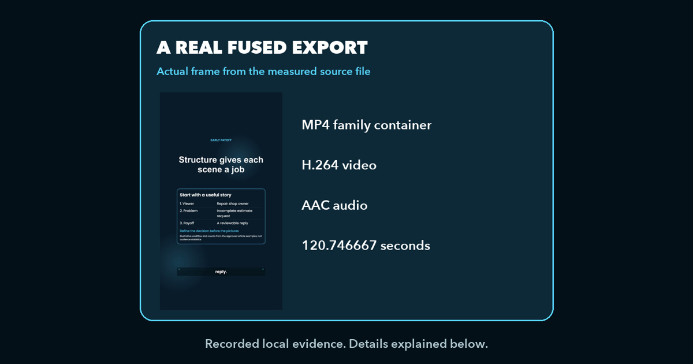

# Use ffprobe to Check What an MP4 Contains

Your file ends in MP4. What does ffprobe say is inside? I answer that question by inspecting an actual export rather than trusting its filename. In this example, a previously approved Fused reel contains H.264 video and AAC audio and measures about 120.75 seconds. Those are recorded properties of that source file, not a promise that a publishing platform will accept it.

The companion lesson is a separate short video. Its duration is different from the source export used in the demonstration. Keeping that distinction visible matters when a graphic contains a large duration counter: the number explains the inspected artifact, not the length of every file in the workflow. Here is how I read the result and decide what to check next.

## Separate the MP4 container from its streams

I think of the container as the file's packaging and the streams as the media held inside it. That analogy helps explain why an extension alone cannot answer every upload question. A file named with an MP4 extension still needs inspection if I want to know the actual video and audio formats represented in the export.

The [official ffprobe documentation](https://ffmpeg.org/ffprobe.html) describes gathering information about multimedia streams and their container. It also documents structured output that another program can read. I use that output to record specific properties rather than copying a filename into a status message and treating the job as complete.

The illustration in the reel shows one MP4 container and its video and audio streams. It is a teaching diagram based on the recorded output, not a screenshot of a publishing dashboard. The diagram explains the relationship between the parts; the separate evidence card contains the measured properties of the actual file.

## Read the result from one real Fused export

For the demonstration, I inspected the previously approved reel about story structure in AI video. I kept its exact file hash with the run record and checked the same bytes again before preparing this lesson. That prevents a later file with a familiar name from silently replacing the source of the example.

The recorded ffprobe result identifies a video stream with codec_name h264 and an audio stream with codec_name aac. It also reports a width of 1080 pixels, a height of 1920 pixels, and a frame rate of 30 frames per second for the video. These values describe this particular source export. They are not presented as universal requirements for social media.

The container's format family appears in ffprobe's format output, alongside its measured duration and size. I keep the unrounded duration in the evidence record, while the reel uses 120.75 seconds for readability. Rounding the display should not replace the original measurement used by a production check.

## Ask ffprobe for the properties you need

For a local file, I use an inspection command that requests format duration and stream information in JSON. A representative command is `ffprobe -v error -show_entries format=duration:stream=codec_type,codec_name,width,height,r_frame_rate -of json example.mp4`. Replace the example filename with the file actually being checked.

That command is an inspection step. It does not convert the media or repair an export. I read the result, confirm which stream is video and which is audio, and keep the fields needed for the next decision. If the command reports a problem, I record that problem instead of inventing a successful result from the extension.

When automation consumes the output, I prefer checking named fields to searching the entire response for a reassuring word. Finding h264 somewhere is weaker than confirming that the video stream reports the expected codec. The same principle applies to duration: identify the measurement being used rather than treating every number in the response as interchangeable.

## Keep the duration attached to the correct file

The inspected source reports 120.746667 seconds. The display counter rounds that to 120.75 seconds. I label the counter as one previously approved Fused file so the reader can tell that it is measured evidence, rather than a suggested target length for this new lesson.

A production record should connect that duration to the exact export. If I later replace a reel, I need a new measurement for the replacement bytes. Keeping the old duration beside a new file can make an upload checklist look complete while describing an artifact nobody is about to publish.

This is closely related to [reusing the right Chatterbox narration](/blog/chatterbox-reuse-audio-check-inputs/). In both cases, a name is only a reference. I need evidence that the referenced artifact still matches the current work. That principle helps separate a completed local file from a verified delivery package.

## Compare measurements with the destination requirements

After inspection, I have facts to compare with the requirements of the destination I intend to use. I check the destination's current documentation or account interface for its actual requirements. This lesson does not claim a Facebook, Buffer, YouTube, Instagram, or X limit, because it demonstrates the local inspection step rather than a platform acceptance test.

I also distinguish the master export from a delivery copy. If a workflow creates a smaller file for a particular destination, I inspect that copy too. Measurements of the master do not establish the properties of a separate derivative, even when both files share most of their name.

Before uploading, I identify the exact local file, its measured properties, the intended destination, and the public media URL if delivery uses a link. That gives a failed upload investigation a concrete starting point. I can ask whether the local file, the hosted copy, or the destination's processing step is the part that needs repair.

## Inspection is followed by playback and delivery checks

A readable metadata report is useful, but I do not treat it as a complete viewing review. I watch and listen to the export. I check the opening, captions, transitions, graphics, and ending against the approved script. A file can have plausible codecs and duration while still containing a design or narration mistake.

Our subtitle repair illustrates that boundary. The short preview needed clean caption replacement on cached chart frames. Metadata inspection alone would not reveal old words accumulating underneath a new phrase. The repair therefore included a separate rendering regression and inspection of actual decoded frames around the reported problem.

The broader [AI video story structure lesson](/blog/why-ai-video-works-better-with-story-structure/) explains why each scene needs a clear job. Media inspection serves a different job: reporting what the file contains. I keep those checks separate so a pass in one area does not stand in for work that has not actually been reviewed.

## A practical file inspection record

For a repeatable workflow, I keep the source filename as a locator, the file hash as an exact reference, the tool version, the requested fields, and the recorded output. I then write down which decision those properties support. That record is more useful than a generic message saying that the video looks ready.

If I change the export, I check the replacement. If I change only the blog's wording, I do not encode the same approved video again. If a hosted file differs from the local copy, I investigate delivery before asking the speech or rendering tools to redo completed work. Those boundaries keep repairs focused.

The opening question now has a concrete answer. In our source example, ffprobe reports H.264 video, AAC audio, and a measured duration of about 120.75 seconds. The filename could not establish those facts. Inspection gives me evidence for the next check, while playback and destination verification remain separate responsibilities.

## Sources and demonstration

- [Official ffprobe documentation](https://ffmpeg.org/ffprobe.html): container and stream inspection, selected fields, and JSON output.
- Fused recorded inspection using ffprobe 8.1.1, checked again November 17, 2026: one previously approved source export, H.264 video, AAC audio, 1080 by 1920 pixels, and 120.746667 seconds.

## Related

- [Why AI video works better with a clear story](/blog/why-ai-video-works-better-with-story-structure/)
- [Reuse the right Chatterbox narration](/blog/chatterbox-reuse-audio-check-inputs/)

Read next: [Use Python to find a missing approval file](/blog/python-find-missing-approval-file/).
