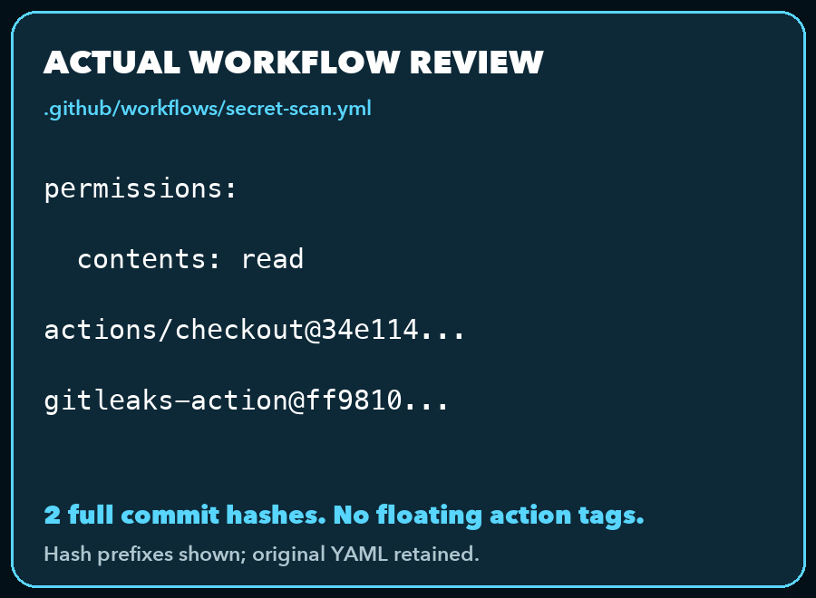
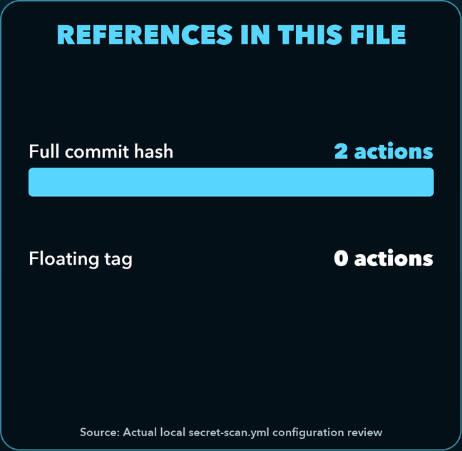

# GitHub Secrets: Check Which Workflow Code Receives the Value

Your API key is stored in GitHub Secrets. Which code can use it? I answer that by reviewing the workflow that receives the credential. Storing a sensitive value outside the source file is useful, but the automation still needs a deliberate boundary around where that value is supplied and which code runs with access to it.

This lesson combines a real configuration review with a labeled teaching diagram. I inspected our repository's secret scan workflow without reading a real secret value or starting a new GitHub Actions run. The diagram then illustrates a step receiving a credential. It is not a screenshot of an actual secret or a claim that an attack was performed against the repository.

## Separate stored secrets from code that uses them

GitHub provides [secret storage for Actions workflows](https://docs.github.com/en/actions/how-tos/write-workflows/choose-what-workflows-do/use-secrets). The workflow must still be designed to supply the right credential to the right work. I do not treat the name of a storage feature as proof that every script, dependency, or job in the automation has been reviewed.

A deployment step may legitimately need a credential to publish an application. That creates a reason to examine what the step executes. If it starts another script or calls an Action, I want to understand that code path too. The sensitive value's storage location and its use during execution are separate parts of the review.

I also distinguish an ordinary configuration value from a credential that authorizes access. The lesson uses names and references rather than real values. Showing a secret's contents would add risk without helping the viewer understand the boundary. A useful explanation can name the credential's purpose, its intended consumer, and the permissions it grants without exposing the credential itself.

## What our actual workflow declares

The local file examined for this lesson is .github/workflows/secret-scan.yml. It declares contents: read for its repository token permissions. It contains two Action references, both pinned to full commit hashes, with no floating Action tags in those references. The run record preserves the file hash so the chart can be traced to the exact configuration inspected.

Those observations describe the YAML file, not a new live execution. I did not test an attack, change repository settings, add a deployment secret, or claim that GitHub processed a new workflow run. That distinction keeps a straightforward source review from being presented as a complete security assessment.

The bar chart counts the two pinned references and the zero floating references in this file. It does not rank the safety of those dependencies or claim that pinning eliminates every supply chain risk. The configuration is a useful example because the reviewer can see the declarations directly and ask what they mean for the job that will run.

## Token permissions and other credentials are different controls

The [GitHub Actions secure use reference](https://docs.github.com/en/actions/reference/security/secure-use) recommends limiting permissions to what a workflow needs. Our example's read only contents permission is a declaration about the repository token. It is not a universal restriction applied to unrelated cloud credentials, service API keys, or other values that a workflow might receive.

That matters when a job combines several responsibilities. A read only repository token does not make a separately supplied deployment credential read only at its provider. I review each credential according to the service it authorizes and the work the job is supposed to perform. The names may appear in the same workflow, while their authority comes from different systems.

For a small business workflow, I start with a plain description of the intended action. A scan needs different access from a production deployment. That description gives the owner a way to question unnecessary permissions before adding code or granting another credential. It also helps explain why a useful automation should not automatically receive every secret associated with the project.

## Follow the credential through the executing step

The reel includes an illustrative sequence: a secret is assigned to a step, the step receives the value, and the code that the step launches can use it. This is a model of the access decision, not an assertion that every job receives every secret by default. The actual workflow configuration determines which references are used.

When I review a credentialed step, I look beyond its friendly display name. I identify the executable, script, or Action that does the work, and then examine the dependency and input paths relevant to that work. A step called deploy can still run code whose behavior deserves review. A reassuring label cannot establish what the process does.

The [environment-variable lesson](https://nextjs.org/docs/app/guides/environment-variables) gives a related example at the application boundary: the destination of a value matters. In a workflow, the equivalent question is which code receives the value during execution. Keeping that question visible is more useful than simply declaring that the secret is stored somewhere secure.

## Keep untrusted contributions away from privileged jobs

A contribution can contain code that has not yet earned the same trust as a reviewed production release. I separate checks on that contribution from jobs that can publish, modify infrastructure, or use privileged credentials. The purpose is to keep the review boundary understandable rather than letting a convenient trigger silently grant a different kind of access.

GitHub's secure use guidance discusses the risks of untrusted code checkout and third party Actions. For this lesson, I show a labeled boundary diagram instead of providing a credential-stealing demonstration. The useful takeaway is to review triggers, permissions, source trust, and credential delivery together, because a single checkbox does not describe the complete execution context.

Pinning an Action to a full commit hash makes the referenced version explicit. It does not tell me whether that version is appropriate or free of vulnerabilities. I still review updates and the code that will run. A fixed reference is evidence about the chosen revision, not permission to stop examining it.

## Review logs without turning them into another secret store

A job's output can become another place where sensitive data appears. I avoid commands that print credentials as a debugging shortcut. GitHub's documentation also cautions that automatic redaction is not guaranteed for every transformed value. I therefore consider how the tools handle errors and output, rather than assuming that masking will cover every path.

A useful status message can report whether a required value was available, which job used it, and whether the intended operation succeeded without echoing the value itself. That makes the record more suitable for review, troubleshooting, and handoff. It also reduces the temptation to paste a complete environment dump into an issue or AI conversation when something fails.

If a credential was exposed, removing it from one log or source file is not the same as invalidating it. GitHub's [sensitive-data removal guidance](https://docs.github.com/en/authentication/keeping-your-account-and-data-secure/removing-sensitive-data-from-a-repository) begins with revocation or rotation for secrets. I keep incident recovery separate from the routine design review demonstrated here.

## Make the review repeatable without overstating it

My record names the inspected file, its hash, the Action references counted, the declared repository-token permissions, and the fact that no new workflow run took place. It also records the limits: no credential value was read, pinning did not establish dependency safety, and the permissions statement did not describe unrelated service credentials.

This follows the same evidence habit used in [checking an MP4 export](/blog/ffprobe-check-mp4-container-video-audio/) and [finding an expected approval file](/blog/python-find-missing-approval-file/). Each check should state what it established and leave the remaining decisions visible. A source configuration review, a successful execution, and an authorized production deployment are different states.

The answer to the hook is that GitHub Secrets stores the value, while the workflow design determines how code receives it. I review the exact code path and access needed for the intended job. The practical next step is to review what your deployment workflow is allowed to access before adding another credential to it.

## Sources and local evidence

- [GitHub: Using secrets in Actions](https://docs.github.com/en/actions/how-tos/write-workflows/choose-what-workflows-do/use-secrets).
- [GitHub: Secure use reference](https://docs.github.com/en/actions/reference/security/secure-use).
- [GitHub: Removing sensitive data](https://docs.github.com/en/authentication/keeping-your-account-and-data-secure/removing-sensitive-data-from-a-repository).
- Fused local configuration review, November 17, 2026: two complete commit-hash Action references, zero floating Action references, and declared contents: read token permissions in secret-scan.yml. No workflow execution or secret-value access was performed for this demonstration.

## Related

- [Use Python to find a missing approval file](/blog/python-find-missing-approval-file/)
- [Use ffprobe to inspect an actual MP4](/blog/ffprobe-check-mp4-container-video-audio/)

Read next: [Reuse Chatterbox audio only when its inputs match](/blog/chatterbox-reuse-audio-check-inputs/).
