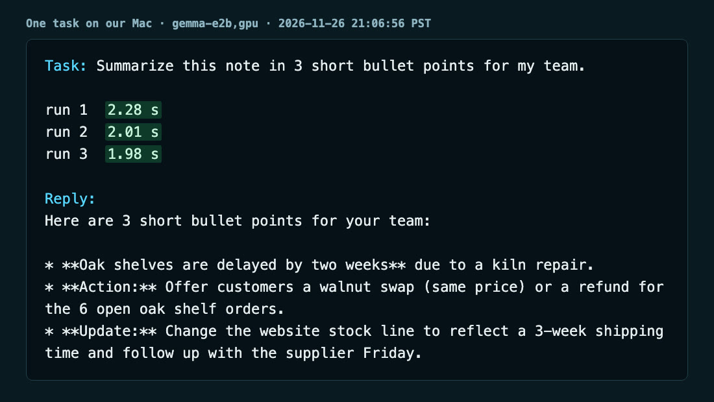
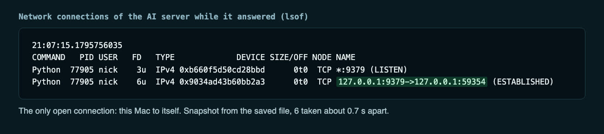
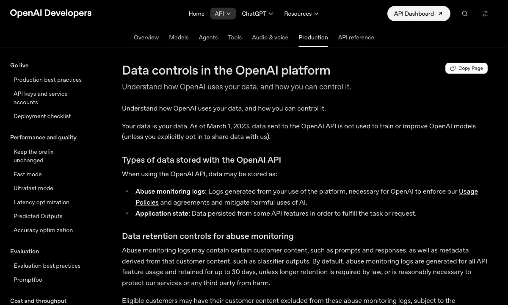

# Some of Our AI Runs on a Desk, Not in the Cloud

Some of our AI runs on a computer on a desk, not in the cloud. It's a small model called Gemma on an 8 GB Mac. When I ask it for a summary of a note, the note stays on that Mac. When I use a cloud AI, the note goes to the provider's servers.

Neither one is better every time. Local keeps the text in the building. Cloud models are bigger and get more right. Here's what I measured on our setup, what the cloud providers say happens to your text, and how I decide which one gets the job.

## One task, timed

I gave the local model a short meeting note and asked for three bullet points for the team. The note is a teaching example I wrote: a supplier delay, six open orders, a website update, a call on Friday.

Three runs: 2.28 seconds, 2.01 seconds and 1.98 seconds, from sending the request to getting the full reply. All three summaries matched the note. For a job like this, the small model is fast enough that I don't wait on it.

## Where the text went

Fast is nice. The part I wanted to see was the network. While the model worked on a longer request, I listed its open network connections six times, about 0.7 seconds apart, using a standard Mac command called lsof.

Every snapshot showed the same thing. One connection from this Mac to itself, which is the request going in, and the port the server listens on. No connection to anywhere outside. The note never left the desk.

The model itself is a 2.6 GB file on the Mac's disk. Nothing has to be downloaded to answer a question.

One thing I found while checking this: our server listens on every network the Mac is connected to, not only on the Mac itself. That means another device on the same network could send it requests. It isn't sending anything out, but it's more open than I thought, and it's worth fixing. If you run a local model, check what address it listens on.

## What the cloud providers say

With a cloud AI, your text does travel. The question is what happens to it once it gets there. I read the data pages from two providers instead of guessing.

OpenAI's developer docs say "data sent to the OpenAI API is not used to train or improve OpenAI models" unless you opt in. They also say: "By default, abuse monitoring logs are generated for all API feature usage and retained for up to 30 days," unless the law or protecting someone from harm requires longer.

Anthropic's privacy center says that for API users, "we automatically delete inputs and outputs on our backend within 30 days of receipt or generation," with exceptions listed on the page, such as content flagged for policy violations.

Both of those describe their developer plans. The chat apps you sign into with a personal account have their own settings, and those can be different. That's the reason to read the data settings for the exact plan you're on, not the provider in general.

## The catch with local

Our local model is small. Earlier this week I asked it what 17 times 24 is. It said 372. The answer is 408. I wrote that test up in [I asked our AI "are you sure?" It said yes and changed its answer](/blog/are-you-sure-flips-the-ai-answer/).

Bigger cloud models handle harder reasoning and longer documents better. Our local model has a short memory for each request, so a long contract or a big spreadsheet won't fit. Local isn't free either. It runs on hardware you own, and on an 8 GB Mac it competes for memory with everything else you have open.

## How I split the work

Here's the rule I use:

1. **Private and simple: local.** Summaries of internal notes, first drafts of short replies, sorting and tagging. The text stays here, and a wrong answer is easy to spot.
2. **Harder work: cloud, after I've checked the settings.** Longer documents, tricky reasoning, anything where the small model keeps missing. Before a new tool gets used, I read its data settings, write down the plan we're on, and turn off training on our inputs if the plan allows it.
3. **Private and hard: swap first.** Replace names and numbers with placeholders before it goes to the cloud. I tested that step in [swap the names before you paste into AI](/blog/swap-the-names-before-you-paste-into-ai/), including the mistake to watch for when you put them back.
4. **Numbers: never trust either one alone.** Redo the math on a calculator or a spreadsheet. The same goes for [a statistic an AI hands you with total confidence](/blog/ai-invented-a-statistic/).

## What this test doesn't show

One task, three runs, one small model, one Mac. It isn't a speed race between local and cloud, and I didn't time a cloud model here. The provider quotes are what their pages said on November 26, 2026. Policies change, so check the current page for your plan.

## Get the SOPs

SOP 9 in my free pack covers what never goes into an AI tool and the three things I check before using a new one. SOP 10 covers connecting AI to email, files or payments. Read them on the [example AI SOPs page](/ai-sops/) or download the PDF from there.

## Sources and local evidence

- Local test, November 26, 2026, 9:07 PM Pacific: Gemma E2B (GPU) on our Mac through LiteRT, temperature 0, max 200 tokens, three timed runs of one summary task. Network snapshots with lsof during a request. Raw requests, replies and snapshots saved.
- OpenAI, [Your data](https://developers.openai.com/api/docs/guides/your-data), developer docs. Accessed November 26, 2026.
- Anthropic, [How long do you store my organization's data?](https://privacy.claude.com/en/articles/7996866-how-long-do-you-store-my-organization-s-data), privacy center. Accessed November 26, 2026.

## Related

- [Swap the names before you paste into AI](/blog/swap-the-names-before-you-paste-into-ai/)
- [I asked our AI "are you sure?" It said yes and changed its answer](/blog/are-you-sure-flips-the-ai-answer/)
- [AI will invent a statistic and say it with total confidence](/blog/ai-invented-a-statistic/)

Read next: [Does your AI know what changed today?](/blog/your-ai-doesnt-know-what-day-it-is/)
