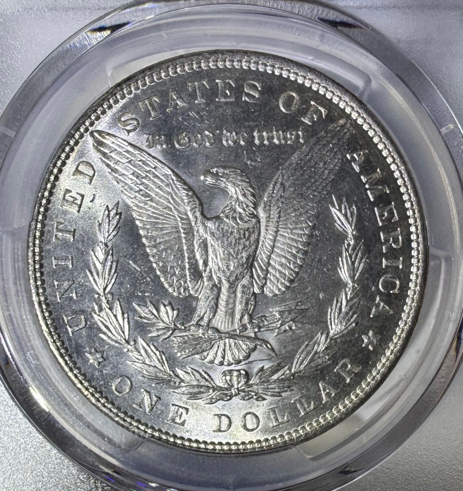
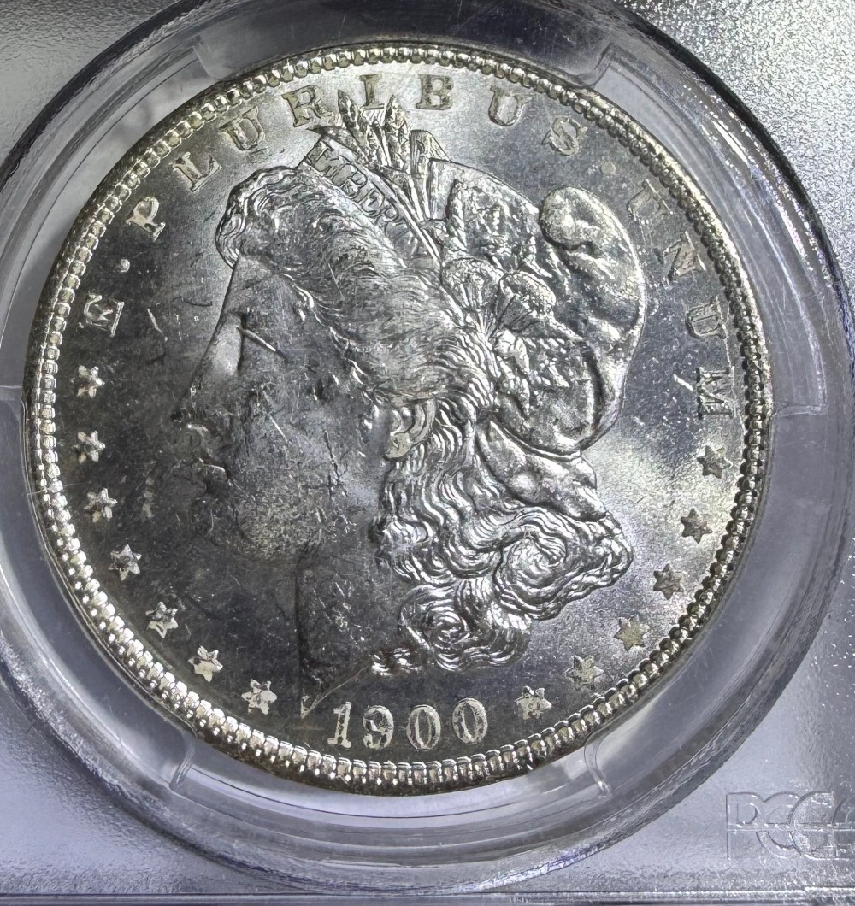

# The Tiny O on a Morgan Dollar Leads to New Orleans History

Why does a Morgan silver dollar carry a tiny O beneath its eagle? That letter points to New Orleans, and to a mint whose history crosses the Civil War. The Louisiana State Museum describes the old building as a mint that produced both American and Confederate coinage. A small mark on a familiar dollar opens a much bigger story about the place that made it.

Our own coin photographs provide the starting point. One shows the reverse of a Morgan dollar with an O below the wreath. Another shows a dollar dated 1900 in a holder labeled 1900-O. These are modern photographs of historic coins, not photographs of nineteenth century production. Look closely at the letter, then follow the building's timeline.

## Find the letter below the wreath

On the reverse photograph, the eagle occupies the center and the wreath curves around it. Follow the wreath toward its bottom. The small O sits above the denomination lettering. It is easy to notice the wings and overlook this much smaller detail.

A mint mark identifies the facility responsible for producing a coin. The U.S. Mint identifies O with New Orleans. It does not mean that the coin is a proof, that it is an error, or that the date begins with a zero. In this photograph, the mark gives us a place to investigate. The larger inscriptions tell other parts of the coin's story.

That distinction makes a useful way to read a coin: date on one side, place on the other. Our guide to [reading a coin from center to rim](/blog/reading-a-coin-design-from-center-to-rim/) offers another way to slow down and notice details that a quick glance misses.

## A southern mint before the Morgan dollar

The building's story began before the Morgan design existed. Congress authorized the New Orleans branch in 1835, alongside branches at Charlotte and Dahlonega. The U.S. Mint explains that those two branches concentrated on gold, while New Orleans produced both gold and silver coins.

New Orleans began minting in 1838. The Morgan dollar did not arrive until decades later. Keeping those two beginnings separate matters: the history of a mint can be much longer than the history of a particular design made there.

Our 1900 obverse photograph shows Liberty with the date below her portrait. The readable date puts that example in the building's later working life. It cannot be an artifact of the mint's opening year. The photograph becomes more interesting when we place the coin within the right chapter rather than treating every event in the building's past as something this dollar witnessed.

## The Civil War interruption

In 1861, the Confederacy gained control of the southern branch mints. The U.S. regained the facilities in 1862, according to the Mint's historical overview. Regaining a building and restarting coin production were separate events.

The Louisiana State Museum describes New Orleans as the only southern mint to reopen after the war, with full operations resuming by 1879. That gap is the turn in the story: a familiar O can lead to a facility that stopped, changed hands and eventually returned to making coins.

The 1900 dollar shown here belongs to that later period. It is not a Confederate dollar. The Civil War connection concerns the mint's earlier history, not the issuing authority of this photographed Morgan. A timeline lets both facts stay visible without sacrificing the surprising connection.

## The Morgan years and the surviving building

George T. Morgan designed the dollar's Liberty portrait and eagle reverse. The original series was produced from 1878 through 1904, then returned in 1921. New Orleans began producing Morgans in 1879 and continued through 1904, according to the Mint's account of the series.

Coin production at New Orleans ended in 1909. The building survived its manufacturing role. It became a Louisiana State Museum site open to the public in 1981, and its coin exhibition preserves the story of the work done there. The museum describes equipment including a coin press and a bullion scale.

The payoff is simple: O means New Orleans, but knowing the place turns a tiny letter into a route through history. On your next coin, would you investigate the date or the mint mark first? For a different kind of close looking, compare [coin lettering styles](/blog/comparing-lettering-styles-on-collectible-coins/) across designs.

## Sources

- [U.S. Mint: Mint Marks](https://www.usmint.gov/learn/collecting-basics/mint-marks)
- [U.S. Mint: History of the U.S. Mint](https://www.usmint.gov/learn/history/overview)
- [U.S. Mint: Celebrating the Iconic Morgan and Peace Silver Dollars](https://www.usmint.gov/news/inside-the-mint/celebrating-the-iconic-morgan-and-peace-silver-dollars)
- [Louisiana State Museum: Old U.S. Mint history](https://louisianastatemuseum.org/museum/new-orleans-jazz-museum-old-us-mint)

## Related

- [Read a coin from center to rim](/blog/reading-a-coin-design-from-center-to-rim/)
- [Compare lettering styles on collectible coins](/blog/comparing-lettering-styles-on-collectible-coins/)

Read next: [Read a coin from center to rim](/blog/reading-a-coin-design-from-center-to-rim/).
