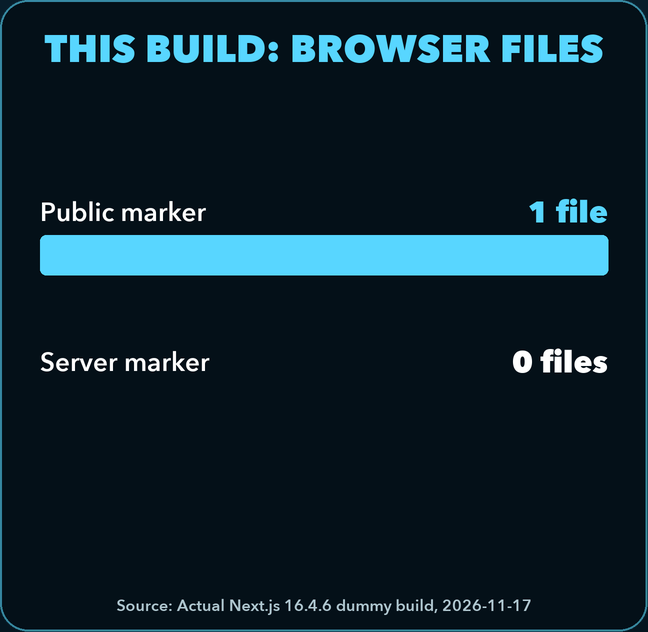

# Your .env File Does Not Make a Browser Variable Secret

Your API key is hidden in .env. Why can visitors still see it? In a Next.js application, a variable intended for the browser can be included in the JavaScript delivered to visitors. Loading that value from an environment file does not change its destination. I check what the build sends to the browser, rather than treating the filename as a security boundary.

I tested this with an isolated Next.js project containing two dummy markers. Neither value was a real credential. One variable used the public prefix. The other was intended for server use. After the build, I inspected the emitted browser JavaScript. This lesson shows the actual result of that check and explains its limits, without claiming that a small example proves an entire application secure.

## Start with the destination of the value

A browser needs access to the values that its JavaScript uses. If I give the browser a private service credential, the fact that I originally stored it in a local file does not make the delivered copy private. The important question is which part of the application receives the value and what that part is allowed to do.

This distinction is easy to miss when an AI assistant helps configure an application. A suggestion to move a value into an environment file may improve organization, while leaving the exposure problem unresolved. I want the review to follow the value from its input through the build and into the running feature. A reassuring filename is not a substitute for that trace.

In the [Next.js environment variable documentation](https://nextjs.org/docs/app/guides/environment-variables), the NEXT_PUBLIC_ prefix identifies values intended to be included in browser code. That behavior can be useful for genuinely public configuration. It is the wrong destination for a credential that must remain private. I check the purpose of the value before choosing how to expose it.

## The local demonstration used dummy markers only

My example used Next.js 16.4.6, Node v24.14.0, and a local production build with Webpack. The project had a simple client page and a separate server route. The client page referenced the public marker. The server route checked whether its server variable was configured and returned only a boolean, rather than returning the marker itself.

The public variable was named NEXT_PUBLIC_DEMO_MARKER. The server variable was named DEMO_SERVER_MARKER. Their values were conspicuously labeled dummy strings, not realistic access tokens. That keeps the exercise focused on where information goes without creating a live credential that could be misused if the example is shared.

I also kept the fixture separate from the production website. Installing packages and building the teaching project did not change the main repository's dependencies, production environment values, or deployment configuration. The example is evidence about this specific build. It is not a claim that a production application was scanned or that an account was compromised.

## What appeared in the browser JavaScript

The build produced 19 browser JavaScript files in its static output. I searched those files for the two exact dummy markers. The public marker appeared in one file. The server marker appeared in none of those browser files. I retained the build version, inspected scope, matching filename, and actual emitted public chunk with the demonstration record.

The reel's bar chart counts files containing each marker in this example. It does not count exposed customer keys, breached accounts, or security failures across other websites. The one and zero values are useful because they make the difference visible while keeping the claim limited to something that was actually measured.

The server marker's absence from those files is also a limited finding. It does not establish that no server value could leak through an API response, an error message, a log, or another page. I checked the emitted browser JavaScript for two known strings. A wider security review would need an explicit scope and evidence for the additional surfaces it examines.

## A public value and a private credential need different treatment

Before moving a value, I ask what it authorizes. Some configuration is designed to be public. Other values grant access to a service, allow changes to data, or let requests consume an account's resources. Calling every configuration value an API key can hide these differences, so I check the provider's documentation for the particular credential and intended use.

When a value must remain private, I keep it on the server side of the feature. The browser makes the permitted request, the server performs the authorized work, and the response contains only what the feature needs. That is a design pattern to review, not proof that every endpoint built around it is automatically safe.

A server route still needs appropriate authentication, authorization, input handling, and limits for its purpose. Moving a secret out of the browser does not decide who may call the route or what requests the route should accept. I treat credential placement and request authorization as separate review questions so one completed change does not hide the other.

## Inspect the actual export before declaring a repair complete

If a private value was exposed to visitors, I do not describe changing its variable name as a complete incident response. I consider whether the credential needs to be revoked or rotated through its provider, and I identify which built or deployed artifacts may still contain it. The safe order depends on the provider and application, but a code edit alone cannot invalidate a credential already copied elsewhere.

For a teaching exercise, I can rebuild with dummy values and inspect the new output. For a real exposure, I preserve useful evidence without pasting the credential into a chat, a ticket, or a public screenshot. Reporting the variable's name, the affected artifact, and the required action is usually more useful than repeating its sensitive value.

The [lesson on checking an MP4 with ffprobe](/blog/ffprobe-check-mp4-container-video-audio/) uses the same evidence habit in a different setting: inspect the exact artifact that will be delivered. A check against an earlier build cannot establish the contents of the replacement that visitors receive. I keep the inspected bytes and the reported result connected.

## Keep the result understandable for the next person

My handoff records the tool version, build mode, dummy inputs, output location, and the exact scope of the search. It also records what was not established. That makes it possible for another person to repeat the example or assess a later change without treating a summary such as “secrets fixed” as the entire review.

The [Python approval-file demonstration](/blog/python-find-missing-approval-file/) explains a related boundary. Finding a file does not establish permission. Here, finding an environment file does not establish secrecy. Both lessons work better when the workflow names the property being checked and avoids turning a narrow observation into a broader claim.

My answer to the hook is practical: the filename is not the boundary. In this build, the public marker reached browser JavaScript, while the server marker was absent from the browser files checked. For your own feature, follow the value to its destination and check which variables the website sends to visitors.

## Sources and local evidence

- [Next.js environment variables](https://nextjs.org/docs/app/guides/environment-variables): documented public-variable behavior.
- [GitHub guidance on exposed credentials](https://docs.github.com/en/authentication/keeping-your-account-and-data-secure/removing-sensitive-data-from-a-repository): revocation and rotation before relying on removal.
- Fused local teaching build, November 17, 2026: Next.js 16.4.6, Webpack, 19 browser JavaScript files checked, one file containing the public dummy marker, and none containing the server dummy marker. No real credential or production account was used.

## Related

- [Use Python to find a missing approval file](/blog/python-find-missing-approval-file/)
- [Use ffprobe to inspect an actual MP4](/blog/ffprobe-check-mp4-container-video-audio/)

Read next: [Reuse Chatterbox audio only when its inputs match](/blog/chatterbox-reuse-audio-check-inputs/).
