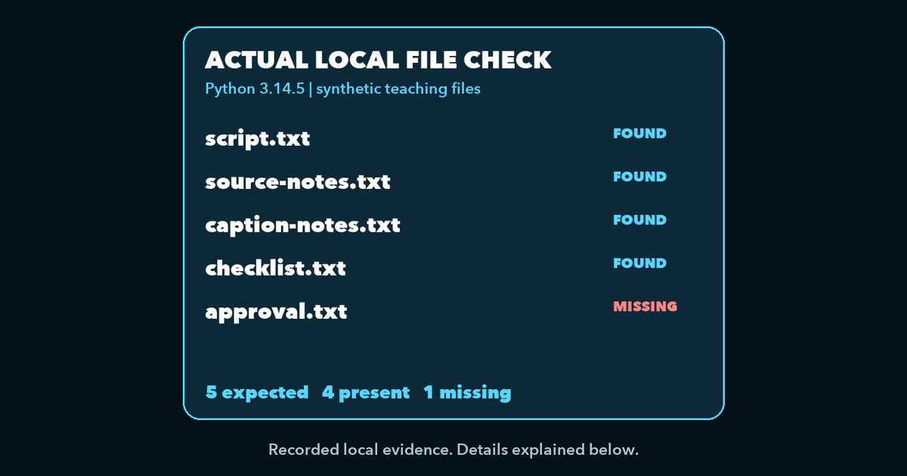

# Use Python to Find a Missing Approval File

Can Python find a missing approval without asking AI? Yes, when the question is which required path is absent. I give a small script an explicit list of expected files, ask it to check each path, and read the missing names. That is a different question from whether a person actually approved the work. The first is a filesystem check. The second requires examining the approval and its authority.

For this lesson, I created synthetic teaching files and ran a real local check. Five filenames were expected. Four existed. The missing item was approval.txt. Those counts describe this example only. They do not measure content quality, production readiness, or the effectiveness of an AI tool. The accompanying reel shows the result and the boundary of the check.

## Start with an explicit Python file list

I begin by writing down what the package should contain. In this example, the list is script.txt, source-notes.txt, caption-notes.txt, checklist.txt, and approval.txt. Each name represents a specific requirement. Keeping that list separate from the folder contents matters: the folder can tell me what is present, but it cannot tell me what I intended to require.

A count alone is weak evidence. A folder could contain four drafts of a script and still lack its source notes. It could include a temporary file that makes the total look correct. Naming each expected path gives the check a clear contract. The result can identify a missing requirement instead of reporting a reassuring total that hides the problem.

I use ordinary text files for the demonstration so the lesson stays focused. These are not customer documents or a claim about an actual client's missing authorization. For the broader planning step, see [how to give AI a useful video brief](/blog/give-ai-a-video-brief-before-asking-for-a-script/). A clear brief and an explicit file list solve related problems: they make expectations visible before production starts.

## Run a small check that names the missing file

The relevant Python operation is Path.is_file. The [Python pathlib documentation](https://docs.python.org/3.14/library/pathlib.html#pathlib.Path.is_file) describes the filesystem query. My demonstration applies it to every name in the declared list. The script builds one list of present files and another of missing files, then prints the results as structured data.

The essential condition is simple: for each expected name, test whether the folder joined with that name is a file. If it is not, add that name to the missing list. I do not ask an AI model to inspect a prose description of the folder or infer which requirement the owner probably meant. The computer checks the actual paths supplied to it.

My recorded run used Python 3.14.5 on a local filesystem. It reported five expected names, four present files, and one missing file. The missing list contained approval.txt. Running a check does not create that file or grant permission to proceed. It gives the production owner a specific condition to resolve.

## Interpret the four present files correctly

The reel's donut shows 80 percent because four of the five expected files existed in this teaching dataset. That percentage is a count of paths, not a score. I would not describe the package as 80 percent approved or 80 percent ready. A single absent requirement can matter more than all of the files already present.

The counter showing one missing file is more useful for the next action. It names approval.txt rather than leaving someone to compare folders manually. I can record a held state, explain the missing requirement, and ask the owner for the appropriate approval. The check has reduced uncertainty about the filesystem without pretending to resolve the human decision.

This distinction also improves reporting. A status message should say that the approval file is missing, rather than saying that the entire workflow failed for an unknown reason. Likewise, four present files should remain recorded as present. Repairing one missing requirement should not require discarding completed work or generating unrelated content again.

## A file's presence is not permission

Imagine adding an empty approval.txt to the folder. The presence check would then see all expected paths. That would establish only that the file exists. It would not establish that the file contains a decision, that the decision covers this version, or that the person who supplied it had authority to approve publication.

I treat those as separate checks. First, confirm the required artifact exists. Next, read the decision and identify what it covers. Then confirm that the decision applies to the current script, images, video, and requested action. A valid approval for a draft does not automatically approve a later edit or a different publishing destination.

For practical content work, I also keep the original owner message. That prevents an assistant's summary from becoming the only supposed evidence of permission. The [workflow for reviewing an AI prompt](/blog/write-a-useful-ai-prompt-for-one-small-business-task/) follows the same principle: make the task and review responsibility explicit rather than relying on a vague instruction that could be interpreted several ways.

## Keep filesystem errors visible

A missing path and a failed attempt to inspect a path are operationally different situations. Before using this pattern in a production job, I decide how that job reports access problems, an unavailable drive, or an unexpected working directory. I do not want an exception to be quietly converted into a claim that the package passed.

The teaching script is intentionally narrow. It checks a controlled local folder with known synthetic files. It is not a general validator for remote storage, file contents, signatures, or media playback. If a real workflow depends on those properties, I add named checks for them and preserve their actual results.

I also keep the folder location explicit. A perfectly correct list checked against the wrong directory produces an unhelpful answer. The run record should make it possible to identify which package was examined, when the check happened, and which expected names were used. That makes later investigation much easier than trying to reconstruct the state from memory.

## Use the result to hold or continue work

My next step depends on the missing list. If it contains approval.txt, I hold the action that requires approval. I can still preserve the script, notes, captions, and checklist already completed. I can report the missing item clearly without rebuilding those artifacts or creating another overlapping production job.

After the owner supplies the required decision, I rerun the relevant checks. If the script or media changed in the meantime, I also review whether that approval still covers the current version. File presence remains one piece of evidence, alongside content review and the exact authorization for the action being taken.

The answer to the opening question is therefore specific. Python can identify a missing expected approval file without asking AI to guess. It cannot turn file presence into permission. I use the small script for the exact check and keep a person responsible for deciding whether production may continue.

## Sources and demonstration

- [Python pathlib reference](https://docs.python.org/3.14/library/pathlib.html): filesystem path operations and Path.is_file.
- Fused local teaching demonstration, checked November 16, 2026: synthetic files with five expected paths, four present, and approval.txt absent. The filesystem result is real; the sample contents are synthetic.

## Related

- [Give AI a video brief before asking for a script](/blog/give-ai-a-video-brief-before-asking-for-a-script/)
- [Write a useful AI prompt for one small business task](/blog/write-a-useful-ai-prompt-for-one-small-business-task/)

Read next: [Look inside an MP4 with ffprobe](/blog/ffprobe-check-mp4-container-video-audio/).
