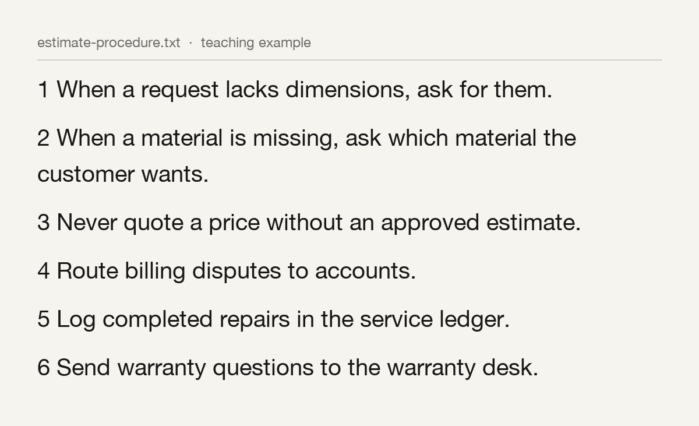
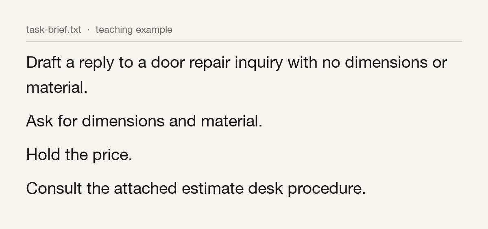
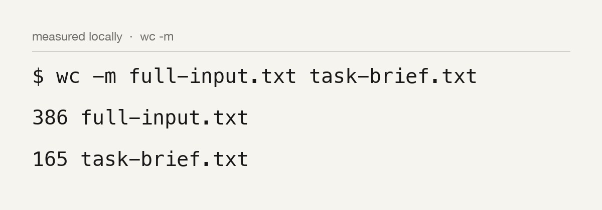

# Your SOP Has Six Rules. This AI Reply Needs Three.

Pasting your whole SOP into every AI request feels safe. You give the tool everything, so it can't miss anything. In practice it hands the AI a pile of rules that have nothing to do with the job in front of it, and leaves it to guess which ones matter.

A better habit: keep one master SOP per desk, and send the AI a short task brief with only the rules that change this one reply. If you haven't written a master SOP yet, start with [what an SOP is and why AI needs one](/blog/what-is-an-sop-and-why-ai-needs-one/).

## The teaching example: one desk, six rules

I wrote a made up estimate desk procedure for a repair shop. It has six numbered rules covering estimates, billing, repairs and warranties.

Then a single inquiry comes in. A customer wants a door repaired. They didn't give the size, and they didn't say what material they want.

Read the six rules against that message. Rule 1 applies: ask for the dimensions. Rule 2 applies: ask for the material. Rule 3 applies: don't quote a price before an approved estimate. Billing disputes, the service ledger and warranty questions have nothing to do with this reply.

Six rules in the manual. Three that touch this job.

## Write the brief

The task brief names the job, lists the three rules, and points to the full procedure as reference.

I measured both inputs locally with `wc -m`. The full pasted input, procedure plus question, is 386 characters. The brief is 165 characters. Less than half.

Be clear about what that number means. It measures the text I typed into the request. If your tool reads the attached procedure, that attachment still takes space. The brief isn't about saving characters. It's about telling the AI which rules matter right now, in the order they matter.

## Keep the master SOP attached

The brief doesn't replace the manual. It points to it. The last line, "Consult the attached estimate desk procedure", tells the tool where the full rules live if it needs them.

Two things to check in your own workspace:

1. Ask the tool to find the pricing rule in the attachment, and compare its wording with your copy. If it can't find it, the tool isn't reading the attachment.
2. If the tool can't open the attachment, paste the needed rule into the brief itself. Never drop a price, safety or privacy rule just to keep the brief short.

## Check the draft against the brief

The brief also gives you a short checklist for the output. For this reply there are two checks:

- Did the draft ask for both details, the size and the material?
- Did it hold the price?

If both are yes, the brief did its job. If either is no, fix the draft by hand or ask for that one change. A person sends the reply, not the AI. For the full review routine, see [drafting a customer email with AI and reviewing it before sending](/blog/draft-a-customer-email-with-ai-and-review-before-sending/).

## When to split a brief

If a task needs more than six rules, it's probably two tasks. A reply that asks for missing details and also settles a billing dispute should be two drafts, each with its own short brief. That keeps every draft easy to check.

A quick test for any brief:

- Every rule in it changes this reply.
- Every rule about price, privacy, safety or legal terms that applies is in it.
- The output line says the format, length and who signs it.
- You can check each rule against one line in the draft.

## Get the templates

I put the master SOP example, the task brief template and ten more AI SOPs into a free pack. Read them on the [example AI SOPs page](/ai-sops/), or download the PDF from there. For writing the request itself, [how to write a useful AI prompt for one small business task](/blog/write-a-useful-ai-prompt-for-one-small-business-task/) covers the rest.

## Sources and local evidence

- Fused teaching files, November 23, 2026: estimate-procedure.txt (six rules), full-input.txt (386 characters), task-brief.txt (165 characters), counted with `wc -m`. The procedure and the inquiry are made up teaching examples, not customer data.
- No claim is made about answer quality, cost or speed. The example shows a method, not a measured result.

## Related

- [What is an SOP and why AI needs one](/blog/what-is-an-sop-and-why-ai-needs-one/)
- [Write a useful AI prompt for one small business task](/blog/write-a-useful-ai-prompt-for-one-small-business-task/)
- [Schedule AI tasks to follow your SOP](/blog/schedule-ai-tasks-to-follow-your-sop/)

Read next: [Draft a customer email with AI and review it before sending](/blog/draft-a-customer-email-with-ai-and-review-before-sending/).
