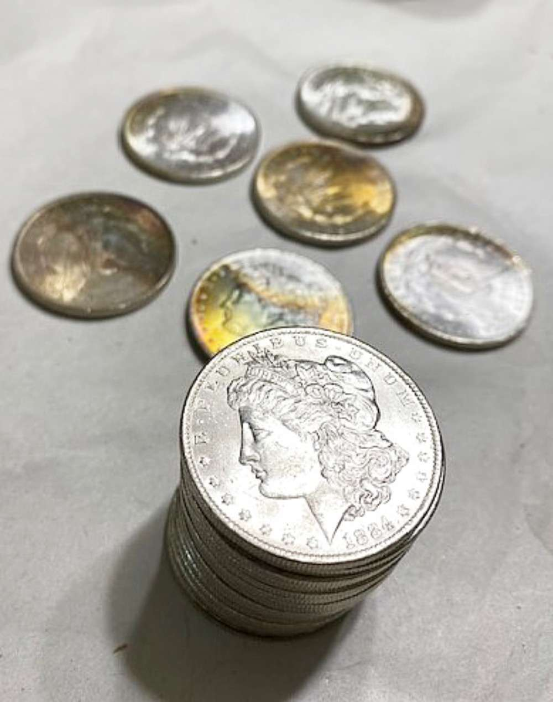
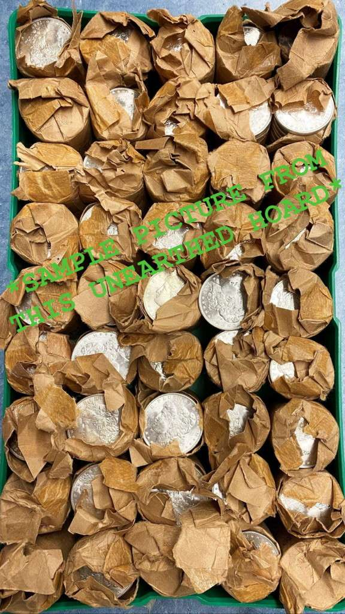
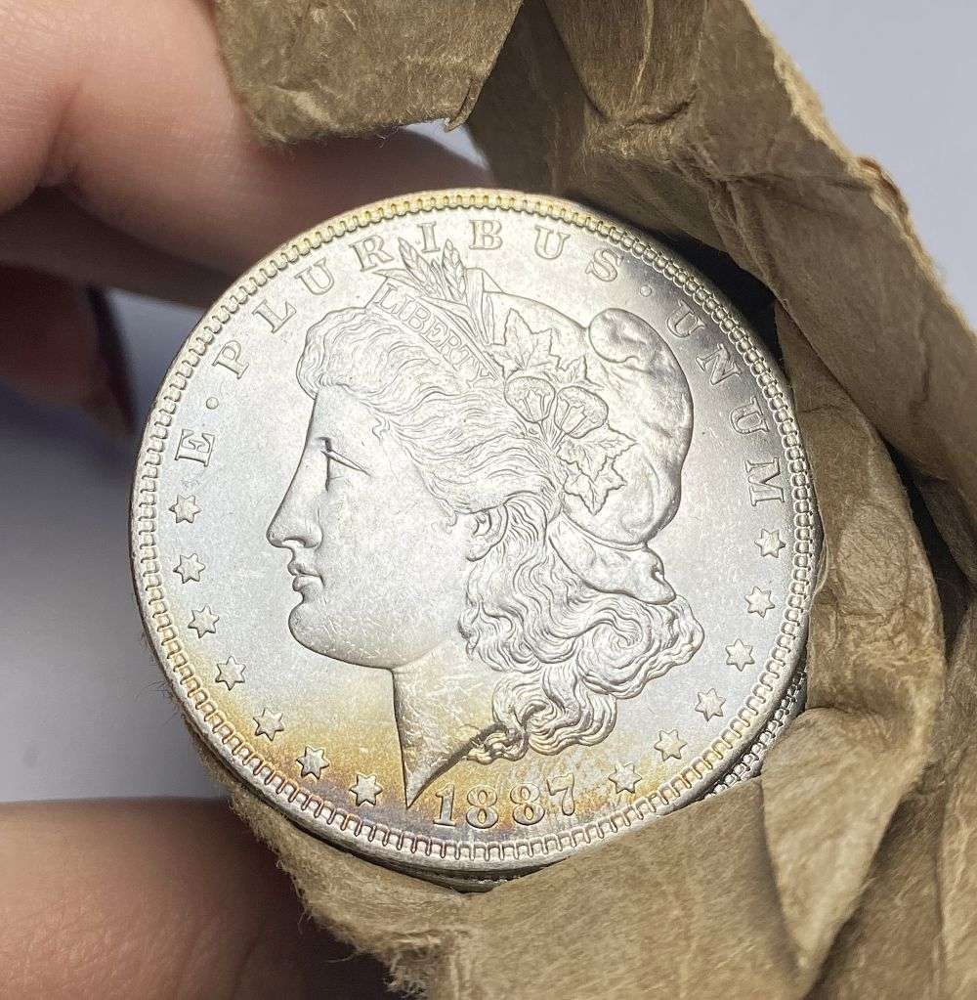
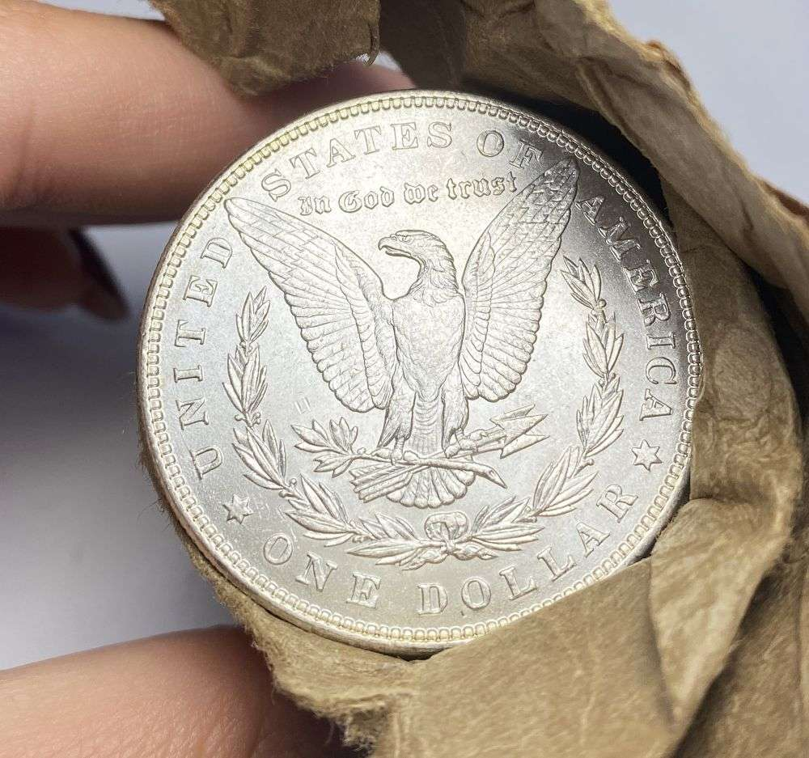

# When a Silver Dollar Bag Changed Rarity: The Hidden-Gem Stories Behind Hoards

A wrapped silver dollar roll invites one question: what could be inside? Coin history offers dramatic answers, but it also offers an important caution. A hoard can reveal rare coins, change the known population of a date, or flood the market with pieces once thought scarce. None of those outcomes can be promised for an unopened roll.

The Morgan dollar began in 1878, following the Bland-Allison Act. The law directed the Treasury to purchase between $2 million and $4 million in silver each month. The resulting dollars were produced in large numbers, and many were stored rather than widely circulated. Later releases from government vaults showed how stored coins could reshape collecting.

## The 1893-S that appeared in an 1894-S bag

In the early 1960s, coin dealer John B. Love discovered 1893-S Morgan dollars mixed into an original bag of 1894-S dollars. The bag had been sealed in early January 1894 and contained a scattering of coins made with dies from the previous year. PCGS estimates that the find accounts for roughly 25 to 30 percent of surviving Mint State 1893-S dollars. Fewer than 100 uncirculated examples are known today.

That is the kind of discovery that gives a roll or bag its hold on collectors’ imagination: not a guarantee of treasure, but a documented case where a container preserved coins that did not match its label. A separate 1893-S example, the Vermeule PCGS MS67 coin, sold for $2,086,875 in August 2021. That result belongs to that specific coin, grade and provenance; it is not a price guide for ordinary Morgan dollars or for the Love find.
For more context on photographed Morgan dollars, see our [Morgan dollar New Orleans story](/blog/morgan-dollar-o-mint-mark-new-orleans/) and [Pittman Act silver dollar history](/blog/pittman-act-silver-dollar-melting/).

## Four hundred bags behind a wall

LaVere Redfield spent decades acquiring silver dollars. After his death in 1974, about 400 bags, roughly 400,000 coins, were found behind a false wall in his basement. PCGS reports that around 85 percent were uncirculated. The hoard sold as one lot in January 1976 for $7.3 million. That is a historical auction result for the entire lot at that time, not a current valuation.

## When a hoard makes a “rarity” common

In 1962, Treasury bags of 1903-O Morgan dollars began appearing in the market. The release changed the coin’s reputation: an issue once treated as a major Mint State rarity was suddenly available in quantity. Carson City dollars held in government vaults later reached collectors through General Services Administration sales. A hoard does not only uncover gems; it can also change the meaning of scarcity.

## What this auction image can and cannot tell us

The supplied wrapped-roll image is explicitly watermarked as a sample from a hoard that had not arrived. It is useful as auction context, but it does not establish what the lot contains. The other supplied photographs show Morgan dollar imagery, including a visibly dated 1887 obverse. The reverse view is a separate specimen, and no mint mark, grade or pairing is inferred.

[View the auction listing](https://auctions.coinssince1994.com/lotview/12243/1917768/0?page=1&scrollLocation=1063&perPage=25&lotSearch=&loc=0&sortby=1&mc_cid=993419266f&mc_eid=b51d7cdd03) for its current terms and description. Any claim about the lot’s contents should follow the seller’s verified listing and inspection, not the historic stories that make dollar hoards fascinating.

## Related

- [Morgan dollar New Orleans story](/blog/morgan-dollar-o-mint-mark-new-orleans/)
- [Pittman Act silver dollar history](/blog/pittman-act-silver-dollar-melting/)

Read next: [Pittman Act silver dollar history](/blog/pittman-act-silver-dollar-melting/)

### Sources

- [U.S. Mint: One Hundred Years of Silver Dollar Coinage](https://www.usmint.gov/news/inside-the-mint/one-hundred-years-of-silver-dollar-coinage-1878-1978)
- [U.S. Mint: The “Crime of 1873” and the Bland-Allison Act](https://www.usmint.gov/news/inside-the-mint/mint-history-crime-of-1873)
- [PCGS CoinFacts: 1893-S Morgan dollar](https://www.pcgs.com/coinfacts/coin/1893-s-1/7226/30)
- [PCGS: The Redfield Hoard](https://www.pcgs.com/news/a-history-of-major-us-hoards-redfield-hoard)
- [PCGS CoinFacts: Treasury releases and Morgan dollar hoards](https://www.pcgs.com/coinfacts/category/dollars/2)
- [PCGS: Vermeule 1893-S sale record](https://www.pcgs.com/news/the-king-of-morgan-dollars-comes-to-greatcollections)
