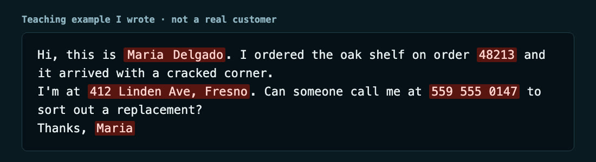
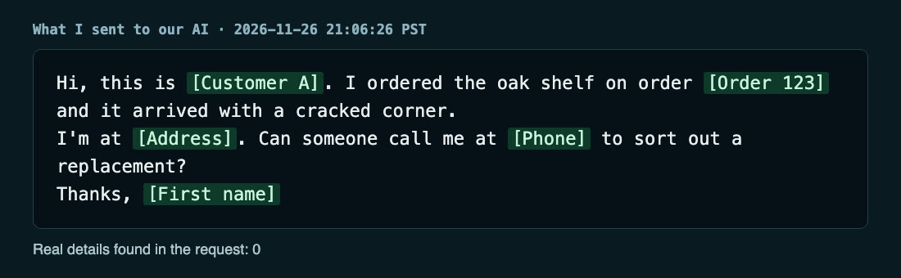
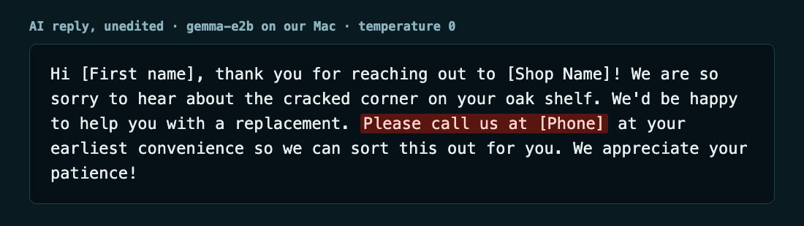
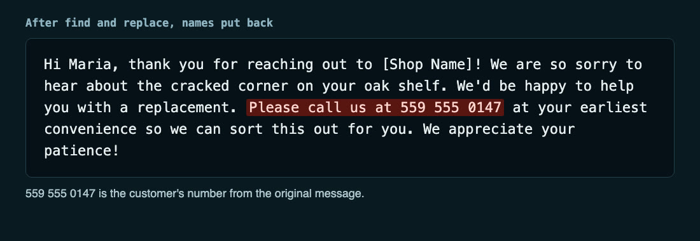
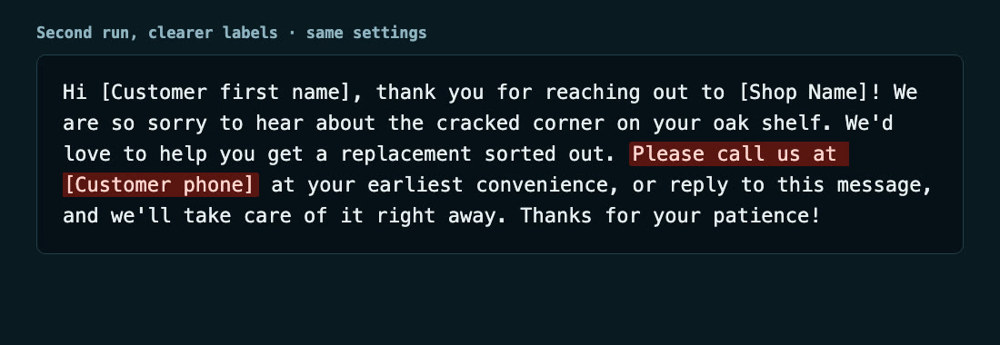

# Swap the Names Before You Paste Into AI

Before you paste that email into AI, swap the names out. The AI doesn't need your customer's name, phone number or street address to write a good reply. It needs to know what happened and what you want to say.

I tested this on November 26 with our own AI, and the swap worked. Not one real detail went into the request, and the reply was friendly and useful. Then I found the part nobody talks about. The AI put one of the placeholders in the wrong spot, and if I'd swapped the names back without reading, I'd have sent the customer her own phone number as ours.

If you already use AI to draft replies, this sits right next to [drafting a customer email with AI and reviewing it before you send](/blog/draft-a-customer-email-with-ai-and-review-before-sending/). This post is about the step before that one, and the step after.

## The example message

I wrote a customer message as a teaching example. Maria isn't a real customer, and the phone number uses the 555 01 range that's set aside for fiction.

It has four things that don't need to leave your business: a full name, an order number, a street address and a phone number. None of them help the AI write a better reply. The useful part is the story: the oak shelf arrived with a cracked corner, and she wants a replacement.

## The swap

Before sending anything, I replaced each detail with a placeholder in square brackets. The full name became [Customer A], the order number became [Order 123], and so on. I kept a small list of which placeholder stands for which real detail. That list never left the Mac.

Then I asked our local AI model, Gemma, to write a short, friendly reply, and I told it to keep the placeholders exactly as they were.

A short script checked the request for each real detail. It found none.

## The reply

The reply came back in about two seconds. It apologized for the cracked corner and offered a replacement. Good tone. Then this line:

"Please call us at [Phone] at your earliest convenience so we can sort this out for you."

[Phone] was Maria's number. She asked us to call her. The AI turned it around and told her to call us, at the placeholder that stands for her own phone.

## What find and replace does with that

Putting the names back is a find and replace. Every [Phone] becomes the real number. The script doesn't know what the sentence means, so it does exactly what it's told.

The final draft tells Maria to call us at 559 555 0147. That's her number. If that went out, she'd be confused at best, and we'd look careless.

There was a second, smaller problem. The AI invented a placeholder I never gave it: [Shop Name]. Find and replace skips it because it isn't on my list, so it would have gone out in brackets.

## I tried clearer labels

My first guess was that [Phone] was too vague. So I ran it again with labels that leave no doubt: [Customer full name], [Customer phone], [Customer address].

Same mistake. "Please call us at [Customer phone]." The label said customer, and the AI still used it as our number. Two runs, same result. Clearer labels are still a good idea, but they didn't fix this.

## The rule I use now

Swap the names out, read the reply, then put them back. Three steps, in that order.

1. **Swap out.** Replace names, phone numbers, addresses, order numbers and anything else private with placeholders. Keep the list of what stands for what on your own computer.
2. **Read the reply with the placeholders still in.** This is where mistakes are easy to see. Check every placeholder. Is it in a sentence where that detail belongs? Did the AI add a placeholder you never used?
3. **Put the details back.** Then read the final version once more before it goes out.

Step 2 takes about thirty seconds. It's the same idea as [having something other than the writer check the work](/blog/ai-graded-its-own-work-wrong-article/): the AI that wrote the reply isn't going to notice it gave the customer her own number.

## Why bother swapping at all

On this test, the AI ran on our own Mac, so the text never left the desk anyway. I still swap, for two reasons. First, the habit carries over to cloud tools, where your text does travel to someone else's servers. Second, a placeholder you never paste can't end up somewhere you didn't expect, like a shared chat history or a log file.

Some things shouldn't go into any AI tool, swapped or not. Passwords, keys and card numbers are on that list. If a key ever does slip into a prompt or a file, [deleting it doesn't revoke it](/blog/deleting-a-leaked-api-key-does-not-revoke-it/).

## What this test doesn't show

One small local model, one teaching example, two runs. I'm not claiming every AI makes this exact mistake, or how often. Bigger models may handle it better. The point is narrower: swapping protects the details, and it adds one new way for a reply to be wrong. Reading the reply before you swap back catches it.

## Get the SOPs

SOP 9 in my free pack is a one page list of what never goes into an AI tool, with the placeholder rule. SOP 8 is the review checklist I run before anything AI drafted gets sent. Read both on the [example AI SOPs page](/ai-sops/) or download the PDF from there.

## Sources and local evidence

- Local test, November 26, 2026, about 9:07 PM Pacific: Gemma E2B (GPU) on our Mac through LiteRT, temperature 0, max 200 tokens. Two runs: short placeholders, then labeled placeholders. Saved for each run: the original, the placeholder list, the exact request, the raw reply, the reply after find and replace, and a leak check of the request (no real details found in either run).
- The customer message is a teaching example written for this test. No real customer data was used.

## Related

- [Draft a customer email with AI, then review it](/blog/draft-a-customer-email-with-ai-and-review-before-sending/)
- [Our AI graded its own work. It was the wrong article.](/blog/ai-graded-its-own-work-wrong-article/)
- [Deleting a leaked API key does not revoke it](/blog/deleting-a-leaked-api-key-does-not-revoke-it/)

Read next: [I asked our AI "are you sure?" It said yes and changed its answer.](/blog/are-you-sure-flips-the-ai-answer/)
