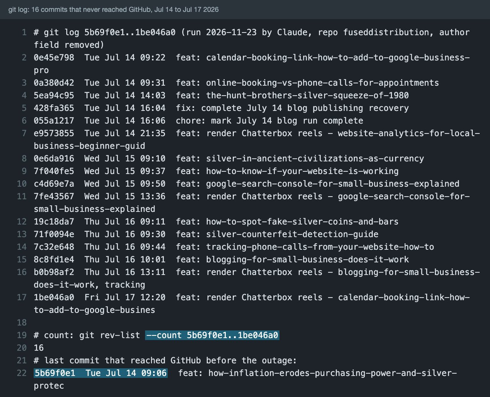
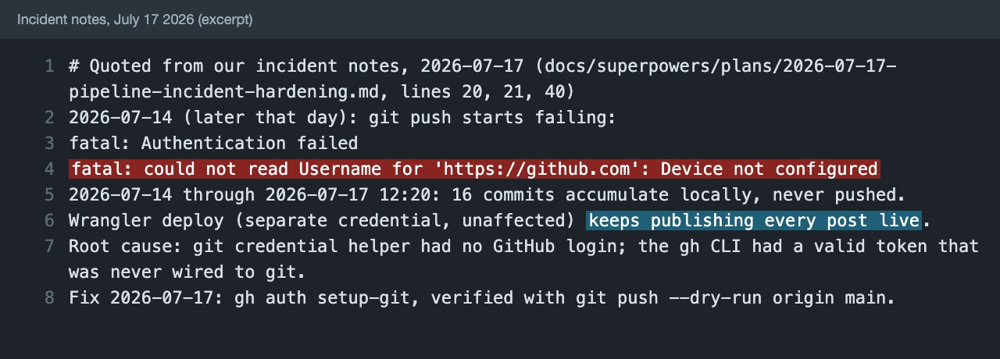
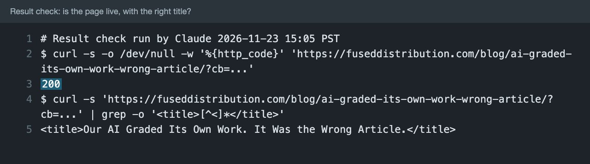

# Our Automation Stopped Backing Up for Three Days. Nothing Told Us.

In July 2026 our blog automation ran every morning, wrote new posts, saved them and put them live on our site. The last step, sending a copy to GitHub as our backup, failed for three days in a row. Sixteen changes piled up on one computer. Nothing told us. We found it during an audit.

The site was fine the whole time. That's what made it easy to miss. The job did most of its work, said it was done, and the one step that failed only wrote a line to a log file. This is what happened, what we changed, and the one habit that would have caught it on day one.

## What the automation was supposed to do

Every morning the job did four things in order:

1. Write the day's posts.
2. Save them on the computer that runs the job.
3. Put them live on fuseddistribution.com.
4. Send a copy of everything to GitHub, so the work exists somewhere other than one machine.

Steps 1 to 3 kept working. Step 4 stopped on July 14.

## What broke

The login the job used for GitHub had dropped. Every attempt to send the copy failed with this:

`fatal: could not read Username for 'https://github.com': Device not configured`

That's the whole message. It went into a log file. No email, no text, no alert on a phone. The job carried on, because it was built not to let a backup problem stop the site from publishing. That part was a good decision. The missing part was telling a person.

From the morning of July 14 to the afternoon of July 17, sixteen changes stacked up locally: new posts, video renders and two recovery commits. The last change GitHub had was from 9:06 on July 14. If that one computer had died on July 16, three days of source files would have been gone. Only the published pages would have survived.

## Why nothing told us

The job checked that it ran. It never checked that the copy arrived.

This is the most common way an automation fails quietly. It reports a status ("done", "success", a green tick) and the status describes the job, not the result. The job did run. It just didn't do the one thing we cared about in step 4.

If you've ever had a scheduled social post that "posted" but never showed up, or a form that "sent" but never reached your inbox, it's the same shape. We wrote about checking that case for social posts in [verify a Buffer post after scheduling it](/blog/verify-a-buffer-post-after-scheduling-it/).

## What we changed

First, we fixed the login. That took one command and a test run that sends nothing.

Then we changed what done means. Our nightly content run now ends by checking results, not statuses:

- **Did the copy reach GitHub?** The push is a required step. If it fails, the run records the failure.
- **Is the new page live?** It loads the page address and checks the reply.
- **Is it the right page?** It checks that the page title matches the new post's title.

Here's that check on a real post, run while I wrote this:

Second, failures go somewhere a person reads. Every run writes a short daily summary: what shipped, what failed, what needs a look. I read that. A log file nobody opens is the same as no warning at all.

## Check the result, not the status

You don't need our setup to use this. For any automation you run, ask one question: what result would prove this worked?

| Automation | Status it reports | Result to check |
|---|---|---|
| Blog post goes live | "Published" | The page loads and shows the new title |
| Weekly backup | "Backup complete" | The backup folder has today's files |
| Invoice reminder email | "Sent" | The email is in the sent folder, to the right address |
| Form to spreadsheet | "Success" | A new row with today's date |
| Social post scheduler | "Scheduled" | The post is visible on the profile at the right time |

Then make the last step of the automation check that result directly, and send any failure to a place you read every day: your inbox, a daily summary, a team chat. Once a week, check one result yourself by hand without looking at the automation's report.

If you're still deciding which steps to automate in the first place, start with [automation is a list of steps](/blog/automate-it-means-a-list-of-steps/). The step list makes it obvious where each result check goes: one after every step that produces something.

## The checklist

This is SOP 16 in my free [example AI SOPs](/ai-sops/): check the result, not the status. It has the steps, a teaching example and the weekly check. SOP 12, the weekly AI review log, is where the hand check goes.

## Sources and local evidence

- Our repo's git history: `git log 5b69f0e1..1be046a0` lists 16 commits from July 14, 2026 09:22 to July 17, 2026 12:20 that were not on GitHub. Commit 5b69f0e1 (July 14, 09:06) was the last one GitHub had before the outage. Run November 23, 2026.
- Our incident notes of July 17, 2026: the push error, the 16 commits, and that the separate publishing step kept every post live. The fix was wiring the GitHub login back up, verified with a test push that sends nothing.
- Result check on a live post, run November 23, 2026: status 200 and the correct page title.
- No claim is made about how often automations fail quietly in general. This is one real case from our own setup.

## Related

- [Verify a Buffer post after scheduling it](/blog/verify-a-buffer-post-after-scheduling-it/)
- [Automation is not a robot. It's a list of steps.](/blog/automate-it-means-a-list-of-steps/)
- [Our AI graded its own work. It was the wrong article.](/blog/ai-graded-its-own-work-wrong-article/)

Read next: [Automation is not a robot. It's a list of steps.](/blog/automate-it-means-a-list-of-steps/)
