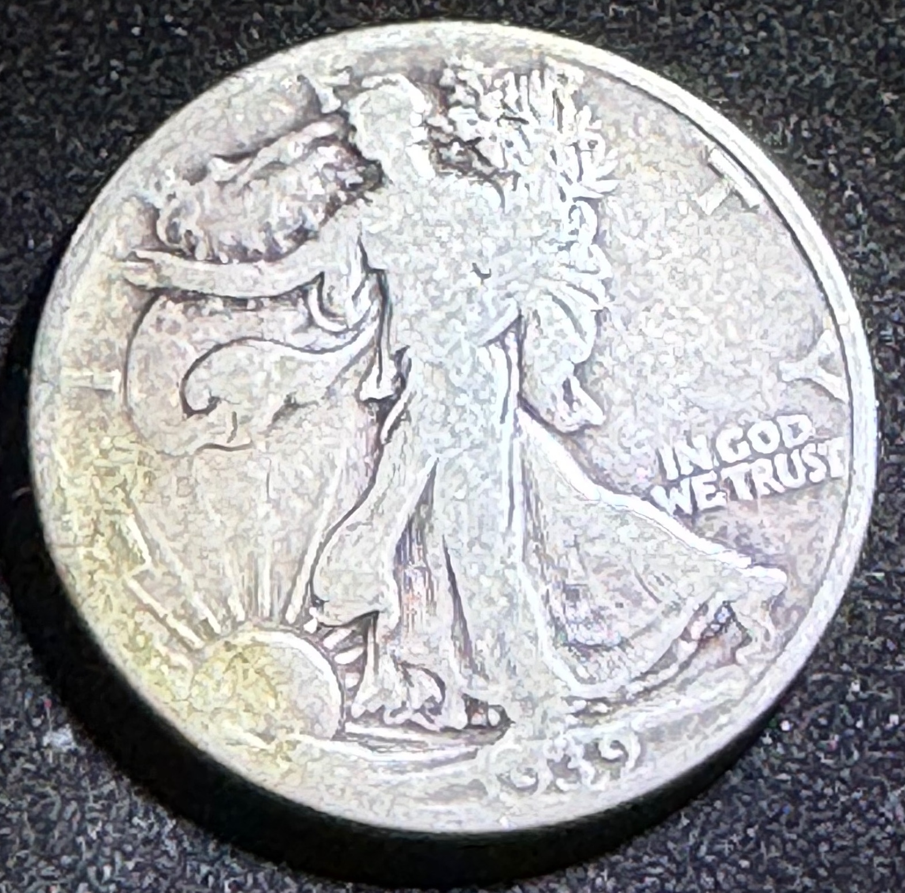
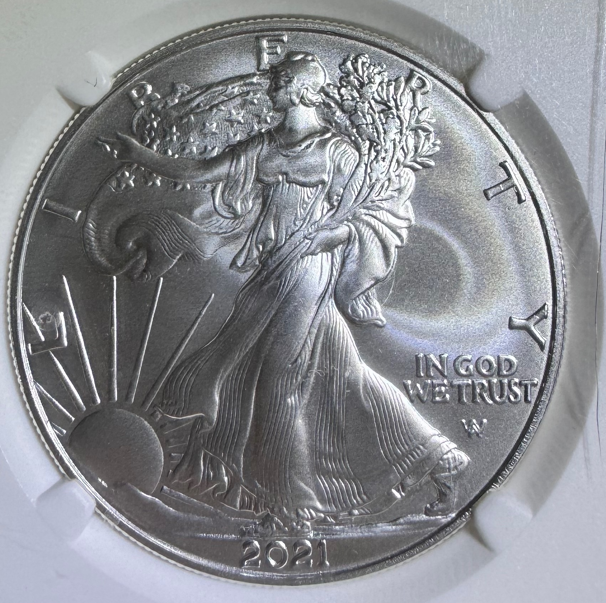
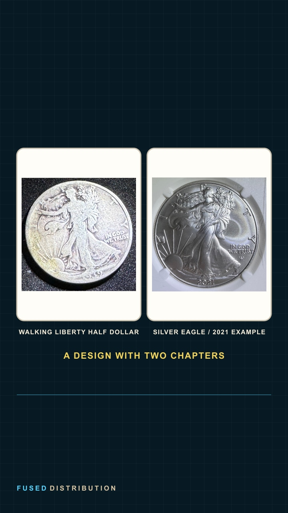

# How the Walking Liberty Design Returned on the Silver Eagle

The same image of Liberty has appeared on two very different American silver coins. One was a circulating half dollar first issued in 1916. The other is the Silver Eagle, a bullion and collector coin introduced in 1986. The connection is Adolph A. Weinman's Walking Liberty design, which left the half dollar and later returned on a new coin program.

## Walking Liberty enters the half dollar

In 1916, the United States Mint began producing Weinman's Walking Liberty half dollar. The obverse shows Liberty in profile, stepping forward in folds of the American flag. Her right arm reaches out, and her left hand carries laurel and oak branches. The rising sun appears at her feet. This arrangement gives the design its forward movement and makes the figure recognizable even when the coin is reduced to a small image.

The reverse uses a different symbol. The Mint describes an eagle perched on a rock, with a pine branch growing beside it. Together, the two sides paired a human figure for Liberty with the national bird. Our photograph here shows the obverse only; it does not establish the reverse of this specific specimen.

## From 1947 to the Franklin half dollar

The Mint produced Walking Liberty half dollars from 1916 through 1947. In 1948, Benjamin Franklin replaced Liberty on the half dollar. The change affected both sides: Franklin appeared on the obverse, while the reverse showed the Liberty Bell. The denomination remained fifty cents, but the coin's visual story moved from an allegorical figure to a portrait of a historical person.

That short timeline matters when comparing a half dollar to a Silver Eagle. The two coins are not the same issue, and the modern coin was not a continuation of half dollar production. The image itself is what connects them.

## The design returns in 1986

In 1986, the Mint launched its American Eagle coin program for investors. The Silver Eagle brought Weinman's Walking Liberty back to the obverse. A figure originally made for a circulating half dollar now appeared on a one-ounce silver bullion coin, alongside versions produced for collectors.

The reuse links two eras with different purposes. The Walking Liberty half dollar was part of the nation's circulating coinage. The Silver Eagle program introduced precious-metal coins for investors and collectors. The obverse gives the newer coin an older visual anchor: Liberty still strides toward the sunrise, while the coin around her belongs to a new program.

## What changed in 2021?

The newer photograph shows a 2021-dated Silver Eagle. That date identifies this example, not the start of Weinman's design's return. In 2021, the Mint refreshed the Silver Eagle's reverse design. The obverse still carries Walking Liberty, so the front and back tell different parts of the program's history: a revived classic on one side and a redesigned eagle on the other.

The photograph in this section is an obverse view. It cannot show the reverse redesign, and we do not use it to claim a mint mark, grade, rarity, or price. The U.S. Mint's program history supports the date and design timeline; the owner photos let readers compare the visible obverse art directly.

## One image, two chapters

Place the two obverse photographs side by side and follow Liberty's stride, extended arm, flag folds, branches, and rising sun. The silver surfaces and the photographic conditions differ, but the design relationship remains visible. The older half dollar presents the original chapter. The 2021 Silver Eagle shows the design still in use on a separate coin.

This is one example of how American coin designs can outlive the coins that first carried them. For another commemorative story tied to a specific place, read about the [Fort Vancouver Centennial half dollar](/blog/fort-vancouver-centennial-half-dollar/). To see how a coin moves from an artist's idea to a struck object, explore [the coin design process](/blog/from-artist-sketch-to-finished-coin-design/).

### Sources

- [U.S. Mint: Half Dollar](https://www.usmint.gov/content/usmint/us/en/learn/coins-and-medals/circulating-coins/half-dollar.html)
- [U.S. Mint: American Eagle Coin Program](https://www.usmint.gov/content/usmint/us/en/learn/coins-and-medals/collectible-coins/american-eagle.html)
- [U.S. Mint: American Eagle Silver Proof Coin](https://www.usmint.gov/content/usmint/us/en/learn/coins-and-medals/collectible-coins/american-eagle/silver-proof.html)

Photographs: Fused Distribution owner-supplied coin images. The half dollar and Silver Eagle are separate photographed examples. Image crops preserve their source design and visible date without generative alteration.

## Related

- [Fort Vancouver Centennial half dollar](/blog/fort-vancouver-centennial-half-dollar/)
- [From artist sketch to finished coin design](/blog/from-artist-sketch-to-finished-coin-design/)

Read next: [From artist sketch to finished coin design](/blog/from-artist-sketch-to-finished-coin-design/)
