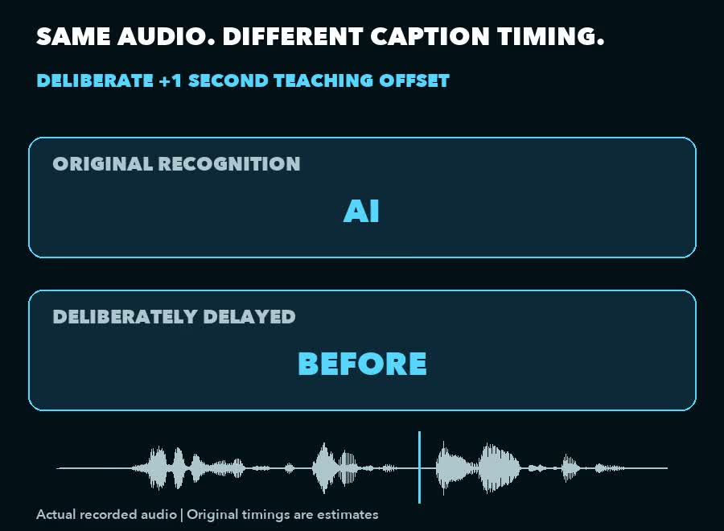

# Whisper Got the Words Right. Why Are the Captions Still Late?

Whisper got every word right. Why are the captions still late? In this lesson, I separate the words recognized in one short recording from the point where those words appear on the video timeline. The example uses a real saved recognition result, then deliberately adds one second to a copy of its caption track.

The added delay is a teaching intervention. It is not an error we measured in the original Whisper run. The comparison keeps the same recorded audio and the same words, making the changed timing explicit. I want a viewer to see which property changed, rather than assume a correct transcript proves that an exported video's captions are correctly placed.

## Check the words Whisper actually recognized

Our source sentence is Label the units before asking AI to calculate. It comes from an authorized local Fused production recording. The saved recognition output contains those words in the same sequence, with punctuation ignored for the text comparison. The audio file's SHA256 matches the value in the recognition provenance.

That establishes a narrow starting point: the checked words belong to this exact recording. It does not establish that every Whisper transcript is correct, or that the timing estimates are independently measured ground truth. Those are different questions that need their own evidence.

The local recognition implementation for this saved result is faster-whisper with the pinned small.en model revision recorded alongside the audio identity. The [Whisper project](https://github.com/openai/whisper) describes the underlying speech recognition model family. The project documentation provides context; our saved files establish what actually happened in this particular production example.

## Text accuracy and placement are different properties

A transcript answers a question about the words in a recording. A timed caption track also needs a decision about when each word or phrase should appear. A video composition then needs to place that track in the intended part of the final sequence.

Those decisions can be inspected separately. In our teaching copy, every word remains unchanged while its start and end times move later. Comparing only the transcript text would miss that alteration. Looking at the timestamp values reveals it immediately.

I do not need to invent an inaccurate recognition result to explain the distinction. An intentionally shifted copy is enough, provided it stays clearly labeled. The lesson concerns the relationship between a track and a timeline, rather than a claim that a named model caused a real production incident.

## Add a known delay without changing the audio

The saved first word begins at 0.08 seconds in the original recognition track. In the deliberately delayed copy, it begins at 1.08 seconds. The teaching code adds 1.00 second to every word's start and end time. It also checks that every word's text remains the same.

The recorded sentence contains eight recognized words. All eight are preserved in the copy, and the added offset is checked for each one. That count describes the particular sentence we used. It is not a word accuracy score for a broader collection of recordings.

The same source audio plays beneath both displays in the encoded comparison. One display uses the original recognition estimates, and the other uses the deliberately shifted track. This makes the chosen difference visible without asking the viewer to compare two separately generated voices.

## Read the decoded comparison carefully

The displayed illustration is a real decoded frame from that encoded comparison. At the selected point, the original track displays AI while the delayed track displays BEFORE. Both tracks contain the same complete sequence; the current displayed word differs because one track is later.

The labels remain attached to the displays. Original recognition identifies the source estimates. Deliberately delayed identifies our modified teaching track. The one second figure describes the change we imposed, not an observed amount by which the original recognizer missed the speech.

The waveform beneath the displays is derived from the actual source recording. It gives the comparison an audio reference without pretending that an attractive shape alone verifies alignment. To assess the timing, I still need to listen to the recording and watch when the relevant words appear.

## Check the final export as well as the timing file

A saved caption file is one input to a video. The final export is the artifact the viewer sees. I therefore keep source checks and final video checks separate. A correct file identity or a plausible timestamp does not, on its own, establish what an encoder actually displayed.

For this example, the comparison was encoded and a frame was extracted from that MP4. That verifies the displayed teaching state at the inspected instant. It does not replace listening to the clip or reviewing the rest of a longer reel, including transitions and the ending.

In a larger composition, I would also inspect the placement of the source audio and the caption track in the overall sequence. If an opening, scene or audio placement changes, the review needs to address the final arrangement. The relevant evidence is the current export, rather than a screenshot from an earlier version.

## Keep caption timing separate from caption clearing

A delayed caption and an overlapping old caption are different defects. One concerns when text appears relative to speech. The other concerns whether expired text remains on screen when a new phrase arrives. They can both affect readability, but they call for different checks.

Our production review checks multiple phrase changes, including the region around sixteen to eighteen seconds and later chart scenes. That helps catch accumulated text that a single midpoint screenshot might miss. It does not automatically prove that every caption follows the spoken word at the intended time.

The lesson's timeline and timing table focus on placement. The final reel still needs the normal caption clearing review. Keeping both checks explicit avoids treating a clean looking frame as a complete assessment of all caption behavior throughout the video.

## Preserve correct work while investigating the mismatch

If the spoken words and recorded voice are already suitable, generating another voice is not the first response to a placement issue. I would compare the actual audio, saved recognition, caption mapping and final encoded result to identify which part differs from the intended sequence.

Changing a correct recording can introduce an additional variable. The [lesson about reusing Chatterbox audio](/blog/chatterbox-reuse-audio-check-inputs/) explains why reuse needs matching inputs and verified files. Here the useful principle is to retain evidence about the known recording while investigating the timing relationship.

That does not mean cached work is automatically valid. If the narration changes, the previous recognition and mapping need review against the changed audio. The point is to repair the part that is actually wrong, while preserving the rejected evidence and the identity of the replacement.

## Make a small, repeatable review

Start with one spoken sentence and its saved words. Listen to the sentence, inspect when the first and last phrases appear, and check a phrase change between them. Then inspect the current encoded video rather than stopping at the source preview.

For a full reel, repeat that review at the opening, a meaningful scene change and the ending. Keep the inspected times and the exact MP4 identity with the result. If an issue appears, describe the actual mismatch instead of attributing it to Whisper without evidence.

An [SOP](/blog/what-is-an-sop-and-why-ai-needs-one/) can make those checks repeatable across editors and assistants. My next action is deliberately small: check the timing on one spoken sentence. Correct words are valuable, and the finished timeline deserves its own check.

## Sources and local evidence

- [Whisper project and documentation](https://github.com/openai/whisper).
- Fused authorized local recording and saved faster-whisper small.en output, November 22, 2026: eight words match the approved sentence; the audio identity matches the recognition provenance.
- Fused encoded teaching comparison: original recognition estimates versus a deliberately added 1.00 second offset. The displayed waveform uses the same recorded audio. No original model timing error or universal accuracy claim is asserted.

## Related

- [Reuse Chatterbox audio only when inputs match](/blog/chatterbox-reuse-audio-check-inputs/)
- [Check what an MP4 actually contains](/blog/ffprobe-check-mp4-container-video-audio/)

Read next: [Use an SOP to keep shared production instructions clear](/blog/what-is-an-sop-and-why-ai-needs-one/).
