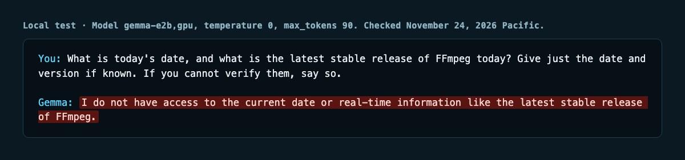
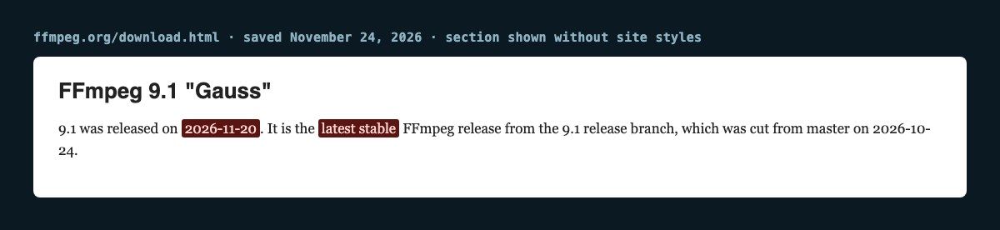

# Does your AI know what changed today?

Ask your AI what today's date is. Then ask it what's new. The second answer is the one that gets people in trouble, because a model can only tell you what was in the text it learned from, and that text stops at a date.

I tested this on our own Mac with a tool we use every day. The model was honest about it. Not every answer is, and a guess can sound just as sure as a right answer. I wrote about that pattern in [AI will invent a statistic and say it with total confidence](/blog/ai-invented-a-statistic/).

## The test

FFmpeg is the free program that turns our footage and voice files into the reels you see on this site. New versions come out over time, so "what's the latest version?" is a fair question with an answer that changes.

On November 24, 2026, I sent this to our local AI model, Gemma, running on the Mac with no web search:

> What is today's date, and what is the latest stable release of FFmpeg today? Give just the date and version if known. If you cannot verify them, say so.

I set the temperature to 0 so the answer would be the same every time, and saved the full reply.

It said it had no access to the current date or real time information, and it gave no version number. That's the good outcome. It didn't guess.

## The answer was one click away

Then I opened the FFmpeg download page myself. Right under the release name was the date: version 9.1, released November 20, 2026, listed as the latest stable release.

That took less than a minute. Now I had three things I could put in my notes: the version, the date on the page, and the link. If anyone asks me next week why we updated, I can show them where the answer came from.

## Why the model can't know

A language model learns from a large pile of text collected up to a cutoff date. After that, it learns nothing new on its own. It also has no clock. Unless the app you're using tells it the date or searches the web for it, the model is working from memory.

Some AI tools now add the date and run a web search behind the scenes. That helps. It doesn't settle the question, because a search can still land on an old blog post or a forum thread from last year. You still need to know which page the answer came from and how old that page is. I go through how to check a link against the claim in [the link was real, the AI claim was still wrong](/blog/ai-citations-check-source-supports-claim/).

## Questions that should make you stop

Watch for these words in a question, from a customer or from yourself:

- latest, newest, current
- today, this week, this year
- still ("is that still the price?")
- a version number or a model year

Each one means the right answer can change over time. That's when an AI answer with no date and no source isn't good enough.

## What to do instead

1. Go to the page that owns the answer. For software, that's the maker's release page. For prices, the supplier's own price list. For rules, the official government page.
2. Write down the answer, the date shown on the page, and the link.
3. If you want AI to write the reply, paste those three things into a short task brief and tell it to use only that. My [task brief method](/blog/shorter-ai-prompts-master-sop-task-brief/) shows the format.
4. Put the date in the reply when it matters. "As of November 24, the latest version is 9.1" ages much better than "the latest version is 9.1."

If the page has no date at all, say so in your notes, or find a page that has one.

## What this doesn't show

This was one question to one small local model on one day. It doesn't tell you how every AI tool behaves, and I'm not claiming a rate. Our model happened to admit it didn't know. The habit matters either way, because you can't tell from the tone of an answer whether the model knows or is guessing.

## Get the checklist

I turned this into SOP 17, "Questions about recent changes: check the date and the source," in my free pack of example AI SOPs. Read it on the [example AI SOPs page](/ai-sops/) or download the PDF from there. SOP 4 is the task brief template that goes with it.

## Sources and local evidence

- Local test, November 24, 2026 Pacific: prompt and full reply from gemma-e2b (GPU) on our Mac, temperature 0, max 90 tokens. Saved as prompt.txt and gemma.json.
- FFmpeg download page, release listing: [ffmpeg.org/download.html](https://ffmpeg.org/download.html). Saved copy November 24, 2026; checked again November 25, 2026. Both show "9.1 was released on 2026-11-20. It is the latest stable FFmpeg release."
- No claim is made about how often other AI tools get dates or versions wrong.

## Related

- [AI will invent a statistic and say it with total confidence](/blog/ai-invented-a-statistic/)
- [The link was real. The AI claim was still wrong.](/blog/ai-citations-check-source-supports-claim/)
- [Your SOP has six rules. This AI reply needs three.](/blog/shorter-ai-prompts-master-sop-task-brief/)

Read next: [Use ffprobe to check what an MP4 contains](/blog/ffprobe-check-mp4-container-video-audio/).
